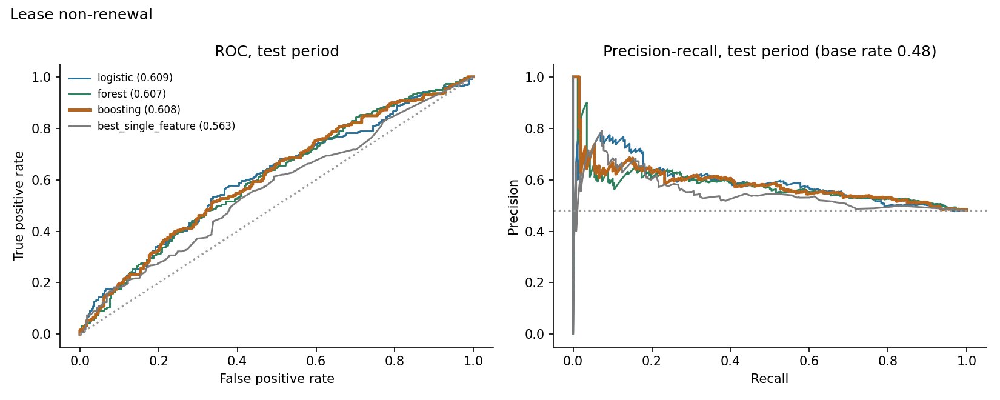
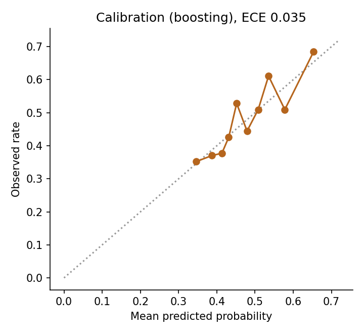
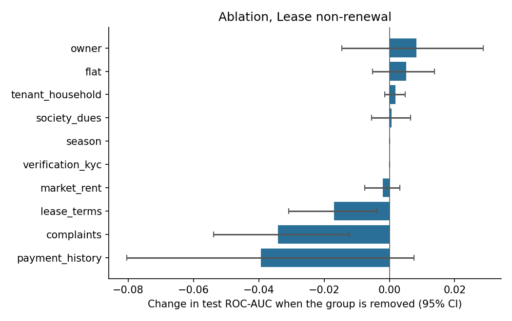
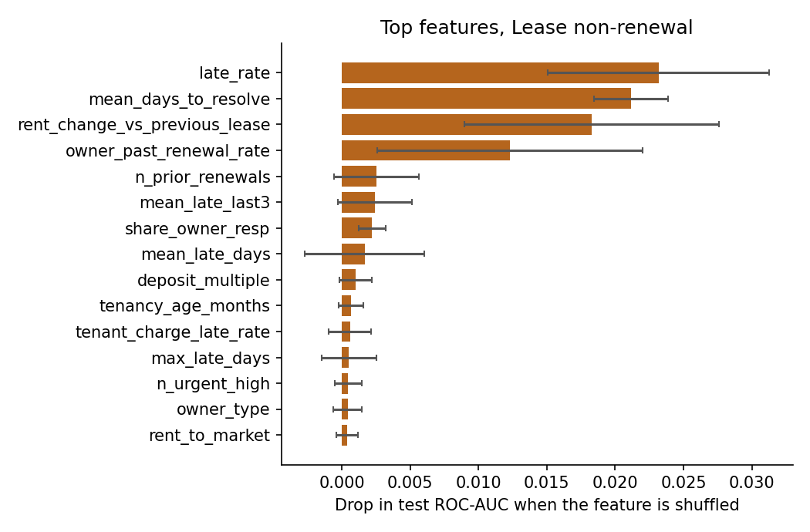
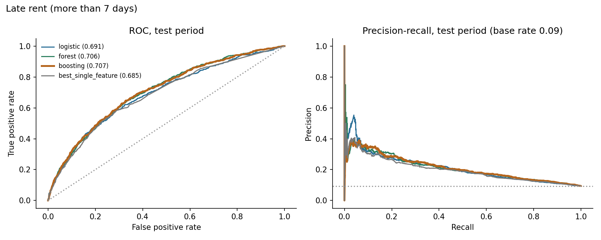
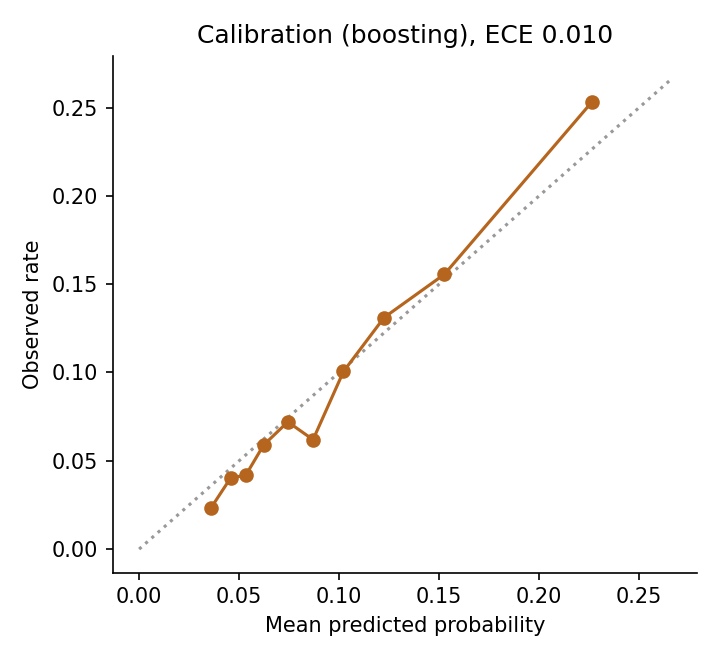
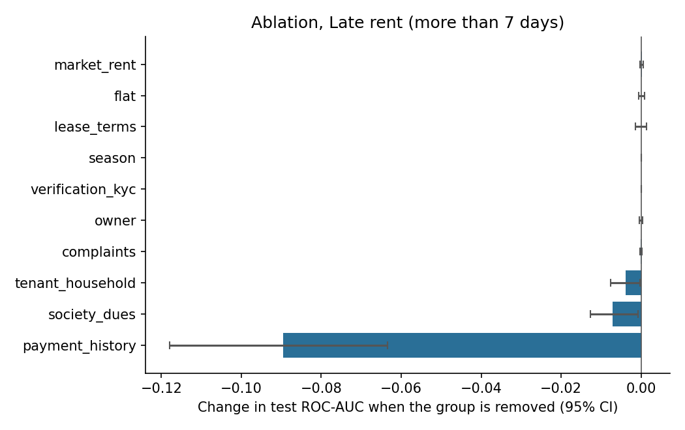
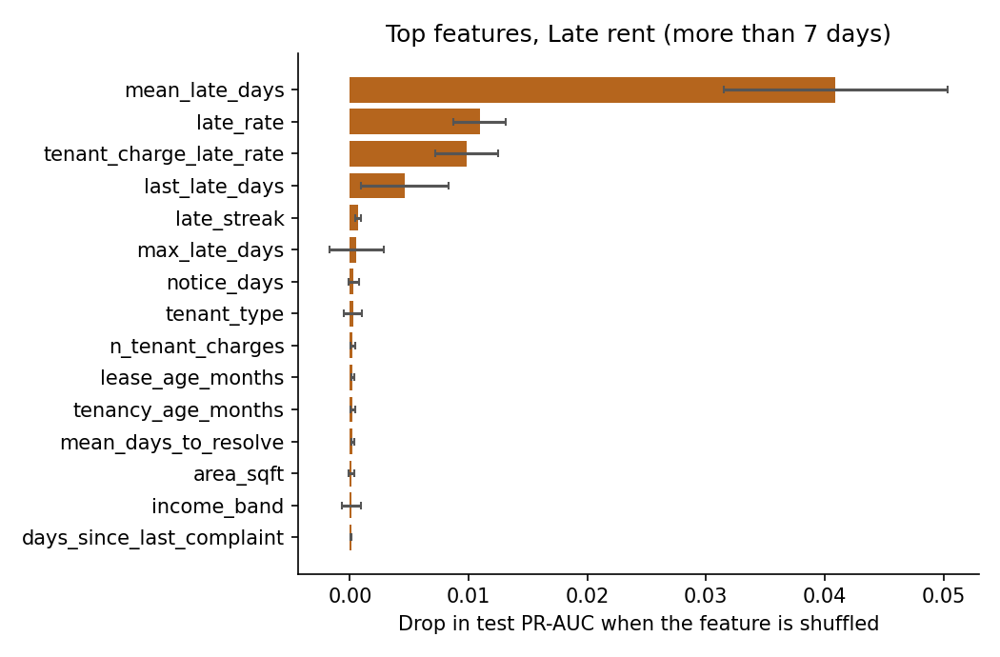

# Results: phase 8 models

All numbers come from the **test period only** (the last 20% of prediction dates), scored once, using models
tuned on the validation period and refit on train+valid. Brackets are 95% cluster-bootstrap intervals
(1000 resamples of whole tenants or leases). The data is synthetic: these results describe the
simulator, not real tenants.

## M1: Lease non-renewal

Rows: train 1562, validation 462, test 536. Positive rate 0.461 overall, 0.481 in the test period. Primary model (best on validation): **boosting**.

### Test results

| Model | ROC-AUC [95% CI] | PR-AUC [95% CI] | Brier | Precision in top 25% | Lift in top 25% |
|---|---|---|---|---|---|
| logistic | 0.609 [0.562, 0.658] | 0.591 [0.531, 0.667] | 0.242 | 0.619 | 1.29 |
| forest | 0.607 [0.556, 0.659] | 0.580 [0.521, 0.653] | 0.242 | 0.597 | 1.24 |
| boosting | 0.608 [0.557, 0.657] | 0.584 [0.526, 0.653] | 0.241 | 0.612 | 1.27 |
| prevalence | 0.500 | 0.458 | 0.250 |  |  |
| best_single_feature (mean_late_days) | 0.563 [0.516, 0.610] | 0.550 [0.493, 0.621] |  | 0.552 | 1.15 |

Gain of the primary model over the best single feature (`mean_late_days`): ROC-AUC +0.045 [+0.006, +0.085], PR-AUC +0.032 [-0.007, +0.070]. For ROC-AUC the interval excludes zero; for PR-AUC it includes zero (a gain that is not clearly different from zero).

Calibration (expected calibration error): 0.035.

### Which feature groups matter (ablation)

Change in test ROC-AUC when a group is removed (same hyperparameters, refit), and the AUC when only that group is used.

| Group | Features | Change if removed [95% CI] | AUC using only this group |
|---|---|---|---|
| payment_history | 10 | -0.039 [-0.080, +0.008] | 0.560 |
| complaints | 10 | -0.034 [-0.054, -0.012] | 0.564 |
| lease_terms | 10 | -0.017 [-0.031, -0.004] | 0.551 |
| market_rent | 3 | -0.002 [-0.008, +0.003] | 0.522 |
| verification_kyc | 3 | +0.000 [+0.000, +0.000] | 0.540 |
| season | 1 | +0.000 [+0.000, +0.000] | 0.535 |
| society_dues | 3 | +0.001 [-0.006, +0.006] | 0.507 |
| tenant_household | 6 | +0.002 [-0.001, +0.005] | 0.513 |
| flat | 4 | +0.005 [-0.005, +0.014] | 0.444 |
| owner | 5 | +0.008 [-0.015, +0.029] | 0.510 |

### Permutation importance (primary model)

| Feature | Drop in test score when shuffled |
|---|---|
| late_rate | 0.0232 (sd 0.0081) |
| mean_days_to_resolve | 0.0212 (sd 0.0027) |
| rent_change_vs_previous_lease | 0.0183 (sd 0.0093) |
| owner_past_renewal_rate | 0.0123 (sd 0.0097) |
| n_prior_renewals | 0.0025 (sd 0.0031) |
| mean_late_last3 | 0.0024 (sd 0.0027) |
| share_owner_resp | 0.0022 (sd 0.0010) |
| mean_late_days | 0.0017 (sd 0.0044) |
| deposit_multiple | 0.0010 (sd 0.0012) |
| tenancy_age_months | 0.0007 (sd 0.0009) |

### Do the predictions track the simulator's hidden traits? (diagnostic only)

- spearman prediction vs hidden final satisfaction: -0.139
- oracle auc knowing hidden final satisfaction: 0.673
- oracle auc knowing hidden initial satisfaction: 0.692
- model auc: 0.608

The oracle AUC is what a scorer that knew the hidden trait exactly would reach on the same test rows. It shows how much headroom the data leaves.

### Chosen hyperparameters (selected on validation only)

- logistic: {'C': 0.01}, validation auc 0.575
- forest: {'leaf': 20}, validation auc 0.624
- boosting: {'depth': 2, 'lr': 0.03, 'iters': 150, 'l2': 5.0}, validation auc 0.6325

## M2: Late rent (more than 7 days)

Rows: train 20427, validation 6967, test 6947. Positive rate 0.097 overall, 0.094 in the test period. Primary model (best on validation): **boosting**.

### Test results

| Model | ROC-AUC [95% CI] | PR-AUC [95% CI] | Brier | Precision in top 10% | Lift in top 10% |
|---|---|---|---|---|---|
| logistic | 0.691 [0.663, 0.716] | 0.210 [0.180, 0.243] | 0.081 | 0.260 | 2.77 |
| forest | 0.706 [0.681, 0.730] | 0.212 [0.182, 0.244] | 0.081 | 0.253 | 2.70 |
| boosting | 0.707 [0.680, 0.729] | 0.211 [0.182, 0.243] | 0.080 | 0.253 | 2.70 |
| prevalence | 0.500 | 0.098 | 0.085 |  |  |
| best_single_feature (mean_late_days) | 0.685 [0.658, 0.710] | 0.196 [0.166, 0.229] |  | 0.240 | 2.56 |

Gain of the primary model over the best single feature (`mean_late_days`): ROC-AUC +0.022 [+0.013, +0.031], PR-AUC +0.016 [+0.004, +0.027]. For ROC-AUC the interval excludes zero; for PR-AUC it excludes zero.

Calibration (expected calibration error): 0.010.

### Which feature groups matter (ablation)

Change in test ROC-AUC when a group is removed (same hyperparameters, refit), and the AUC when only that group is used.

| Group | Features | Change if removed [95% CI] | AUC using only this group |
|---|---|---|---|
| payment_history | 10 | -0.090 [-0.118, -0.063] | 0.699 |
| society_dues | 3 | -0.007 [-0.013, -0.001] | 0.590 |
| tenant_household | 6 | -0.004 [-0.008, -0.000] | 0.582 |
| complaints | 10 | -0.000 [-0.000, +0.000] | 0.517 |
| owner | 5 | -0.000 [-0.000, +0.000] | 0.515 |
| verification_kyc | 3 | +0.000 [+0.000, +0.000] | 0.522 |
| season | 1 | +0.000 [+0.000, +0.000] | 0.501 |
| lease_terms | 9 | +0.000 [-0.001, +0.001] | 0.520 |
| flat | 4 | +0.000 [-0.001, +0.001] | 0.528 |
| market_rent | 3 | +0.000 [-0.000, +0.000] | 0.508 |

### Permutation importance (primary model)

| Feature | Drop in test score when shuffled |
|---|---|
| mean_late_days | 0.0409 (sd 0.0094) |
| late_rate | 0.0109 (sd 0.0022) |
| tenant_charge_late_rate | 0.0098 (sd 0.0027) |
| last_late_days | 0.0046 (sd 0.0037) |
| late_streak | 0.0007 (sd 0.0002) |
| max_late_days | 0.0006 (sd 0.0023) |
| notice_days | 0.0003 (sd 0.0004) |
| tenant_type | 0.0003 (sd 0.0008) |
| n_tenant_charges | 0.0002 (sd 0.0002) |
| lease_age_months | 0.0002 (sd 0.0001) |

### Do the predictions track the simulator's hidden traits? (diagnostic only)

- spearman prediction vs hidden reliability: -0.632
- oracle auc knowing hidden reliability: 0.774
- model auc: 0.707

The oracle AUC is what a scorer that knew the hidden trait exactly would reach on the same test rows. It shows how much headroom the data leaves.

### Chosen hyperparameters (selected on validation only)

- logistic: {'C': 0.1}, validation ap 0.1944
- forest: {'leaf': 50}, validation ap 0.1974
- boosting: {'depth': 2, 'lr': 0.03, 'iters': 150, 'l2': 5.0}, validation ap 0.1986
