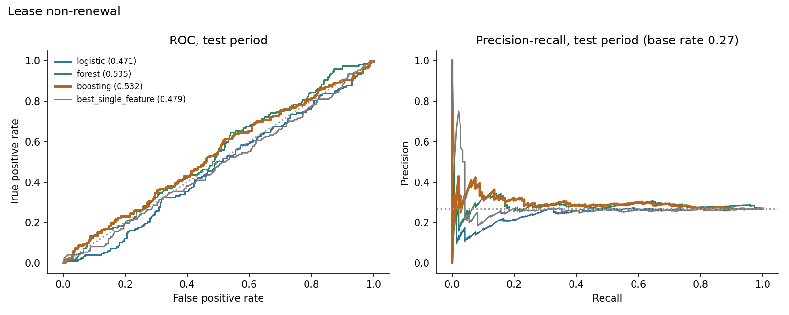
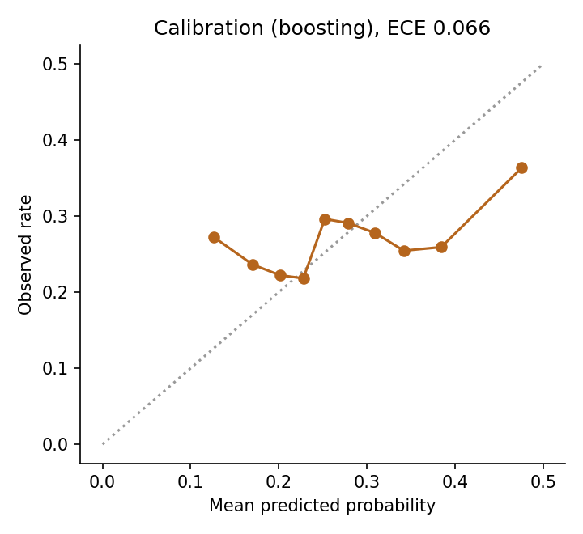
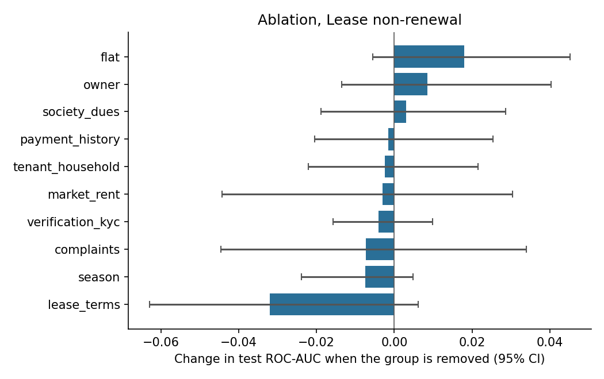
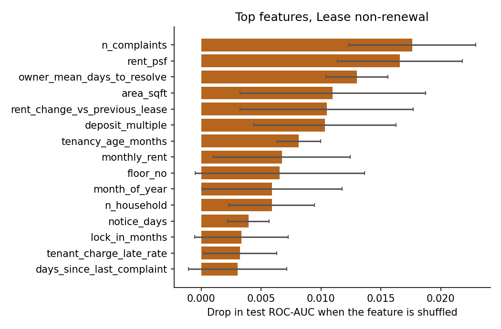

# Results: phase 8 models

All numbers come from the **test period only** (the last 20% of prediction dates), scored once, using models
tuned on the validation period and refit on train+valid. Brackets are 95% cluster-bootstrap intervals
(200 resamples of whole tenants or leases). The data is synthetic: these results describe the
simulator, not real tenants.

## M1: Lease non-renewal

Rows: train 1536, validation 480, test 546. Positive rate 0.272 overall, 0.269 in the test period. Primary model (best on validation): **boosting**.

### Test results

| Model | ROC-AUC [95% CI] | PR-AUC [95% CI] | Brier | Precision in top 25% | Lift in top 25% |
|---|---|---|---|---|---|
| logistic | 0.471 [0.432, 0.518] | 0.246 [0.214, 0.291] | 0.208 | 0.212 | 0.79 |
| forest | 0.535 [0.486, 0.587] | 0.288 [0.246, 0.359] | 0.198 | 0.277 | 1.03 |
| boosting | 0.532 [0.476, 0.584] | 0.298 [0.245, 0.367] | 0.203 | 0.285 | 1.06 |
| prevalence | 0.500 | 0.268 | 0.197 |  |  |
| best_single_feature (owner_mean_days_to_resolve) | 0.479 [0.421, 0.536] | 0.272 [0.222, 0.336] |  | 0.263 | 0.98 |

Gain of the primary model over the best single feature (`owner_mean_days_to_resolve`): ROC-AUC +0.054 [-0.014, +0.125], PR-AUC +0.029 [-0.030, +0.083]. For ROC-AUC the interval includes zero; for PR-AUC it includes zero (a gain that is not clearly different from zero).

Calibration (expected calibration error): 0.066.

### Which feature groups matter (ablation)

Change in test ROC-AUC when a group is removed (same hyperparameters, refit), and the AUC when only that group is used.

| Group | Features | Change if removed [95% CI] | AUC using only this group |
|---|---|---|---|
| lease_terms | 10 | -0.032 [-0.063, +0.006] | 0.512 |
| season | 1 | -0.007 [-0.024, +0.005] | 0.487 |
| complaints | 10 | -0.007 [-0.045, +0.034] | 0.525 |
| verification_kyc | 3 | -0.004 [-0.016, +0.010] | 0.495 |
| market_rent | 3 | -0.003 [-0.044, +0.030] | 0.521 |
| tenant_household | 6 | -0.002 [-0.022, +0.022] | 0.516 |
| payment_history | 10 | -0.002 [-0.021, +0.025] | 0.499 |
| society_dues | 3 | +0.003 [-0.019, +0.029] | 0.468 |
| owner | 5 | +0.008 [-0.013, +0.040] | 0.468 |
| flat | 4 | +0.018 [-0.006, +0.045] | 0.441 |

### Permutation importance (primary model)

| Feature | Drop in test score when shuffled |
|---|---|
| n_complaints | 0.0176 (sd 0.0053) |
| rent_psf | 0.0166 (sd 0.0052) |
| owner_mean_days_to_resolve | 0.0130 (sd 0.0026) |
| area_sqft | 0.0110 (sd 0.0078) |
| rent_change_vs_previous_lease | 0.0105 (sd 0.0072) |
| deposit_multiple | 0.0103 (sd 0.0059) |
| tenancy_age_months | 0.0081 (sd 0.0018) |
| monthly_rent | 0.0067 (sd 0.0057) |
| floor_no | 0.0066 (sd 0.0071) |
| month_of_year | 0.0059 (sd 0.0058) |

### Do the predictions track the simulator's hidden traits? (diagnostic only)

- spearman prediction vs hidden final satisfaction: 0.030
- oracle auc knowing hidden final satisfaction: 0.441
- oracle auc knowing hidden initial satisfaction: 0.497
- model auc: 0.532

The oracle AUC is what a scorer that knew the hidden trait exactly would reach on the same test rows. It shows how much headroom the data leaves.

### Chosen hyperparameters (selected on validation only)

- logistic: {'C': 1.0}, validation auc 0.5256
- forest: {'leaf': 5}, validation auc 0.5255
- boosting: {'depth': 3, 'lr': 0.06, 'iters': 300, 'l2': 5.0}, validation auc 0.5315
