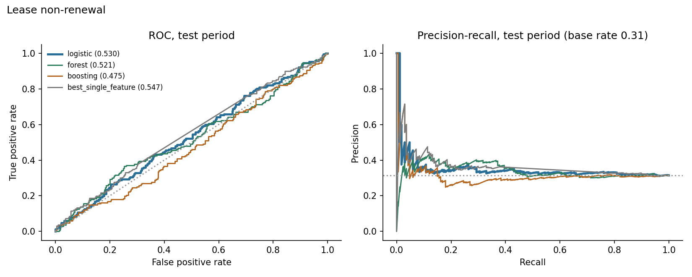
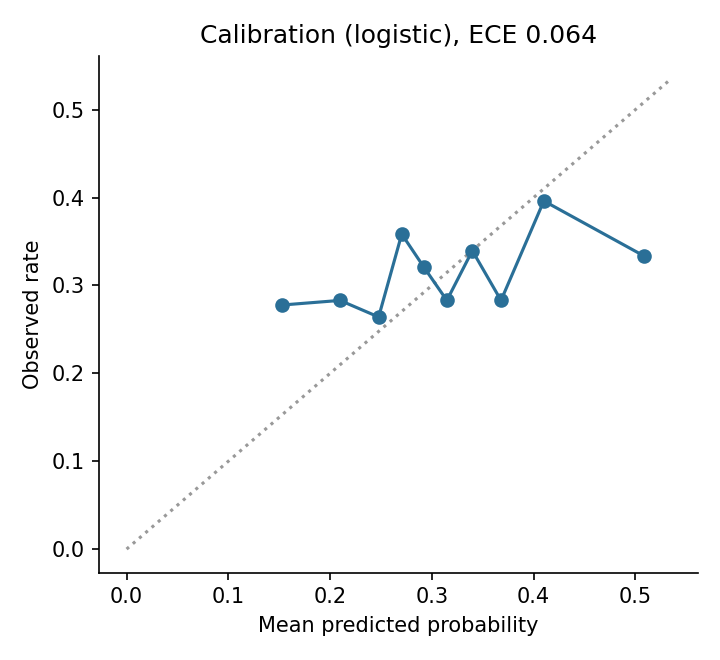
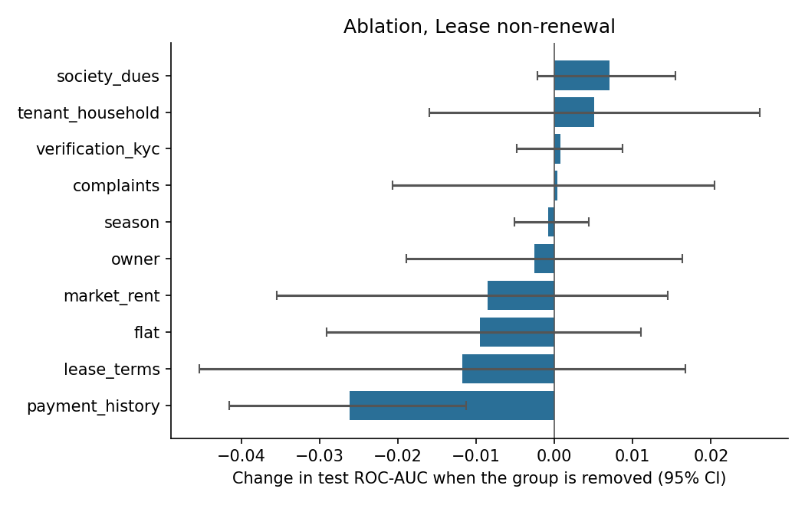
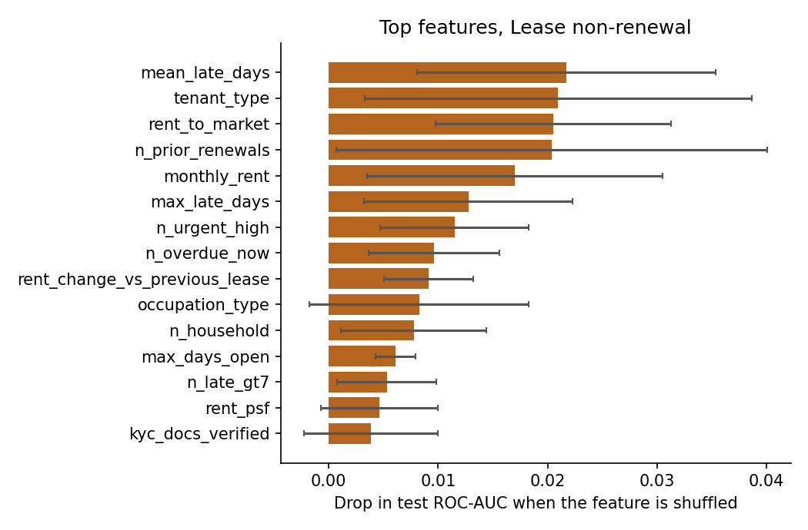

# Results: phase 8 models

All numbers come from the **test period only** (the last 20% of prediction dates), scored once, using models
tuned on the validation period and refit on train+valid. Brackets are 95% cluster-bootstrap intervals
(200 resamples of whole tenants or leases). The data is synthetic: these results describe the
simulator, not real tenants.

## M1: Lease non-renewal

Rows: train 1532, validation 508, test 532. Positive rate 0.289 overall, 0.314 in the test period. Primary model (best on validation): **logistic**.

### Test results

| Model | ROC-AUC [95% CI] | PR-AUC [95% CI] | Brier | Precision in top 25% | Lift in top 25% |
|---|---|---|---|---|---|
| logistic | 0.530 [0.478, 0.575] | 0.350 [0.292, 0.410] | 0.220 | 0.361 | 1.15 |
| forest | 0.521 [0.474, 0.572] | 0.342 [0.288, 0.405] | 0.218 | 0.398 | 1.27 |
| boosting | 0.475 [0.427, 0.534] | 0.319 [0.266, 0.384] | 0.230 | 0.263 | 0.84 |
| prevalence | 0.500 | 0.284 | 0.216 |  |  |
| best_single_feature (rent_change_vs_previous_lease) | 0.547 [0.500, 0.602] | 0.358 [0.299, 0.426] |  | 0.353 | 1.13 |

Gain of the primary model over the best single feature (`rent_change_vs_previous_lease`): ROC-AUC -0.020 [-0.080, +0.044], PR-AUC -0.010 [-0.065, +0.036]. For ROC-AUC the interval includes zero; for PR-AUC it includes zero (a gain that is not clearly different from zero).

Calibration (expected calibration error): 0.064.

### Which feature groups matter (ablation)

Change in test ROC-AUC when a group is removed (same hyperparameters, refit), and the AUC when only that group is used.

| Group | Features | Change if removed [95% CI] | AUC using only this group |
|---|---|---|---|
| payment_history | 10 | -0.026 [-0.042, -0.011] | 0.524 |
| lease_terms | 10 | -0.012 [-0.045, +0.017] | 0.525 |
| flat | 4 | -0.009 [-0.029, +0.011] | 0.504 |
| market_rent | 3 | -0.009 [-0.035, +0.014] | 0.522 |
| owner | 5 | -0.003 [-0.019, +0.016] | 0.525 |
| season | 1 | -0.001 [-0.005, +0.004] | 0.518 |
| complaints | 10 | +0.000 [-0.021, +0.020] | 0.509 |
| verification_kyc | 3 | +0.001 [-0.005, +0.009] | 0.505 |
| tenant_household | 6 | +0.005 [-0.016, +0.026] | 0.500 |
| society_dues | 3 | +0.007 [-0.002, +0.016] | 0.459 |

### Permutation importance (primary model)

| Feature | Drop in test score when shuffled |
|---|---|
| mean_late_days | 0.0217 (sd 0.0136) |
| tenant_type | 0.0210 (sd 0.0177) |
| rent_to_market | 0.0205 (sd 0.0108) |
| n_prior_renewals | 0.0204 (sd 0.0197) |
| monthly_rent | 0.0170 (sd 0.0135) |
| max_late_days | 0.0128 (sd 0.0095) |
| n_urgent_high | 0.0115 (sd 0.0068) |
| n_overdue_now | 0.0097 (sd 0.0060) |
| rent_change_vs_previous_lease | 0.0091 (sd 0.0040) |
| occupation_type | 0.0083 (sd 0.0100) |

### Do the predictions track the simulator's hidden traits? (diagnostic only)

- spearman prediction vs hidden final satisfaction: 0.150
- oracle auc knowing hidden final satisfaction: 0.462
- oracle auc knowing hidden initial satisfaction: 0.512
- model auc: 0.530

The oracle AUC is what a scorer that knew the hidden trait exactly would reach on the same test rows. It shows how much headroom the data leaves.

### Chosen hyperparameters (selected on validation only)

- logistic: {'C': 1.0}, validation auc 0.531
- forest: {'leaf': 5}, validation auc 0.496
- boosting: {'depth': 2, 'lr': 0.03, 'iters': 300, 'l2': 0.0}, validation auc 0.5108
