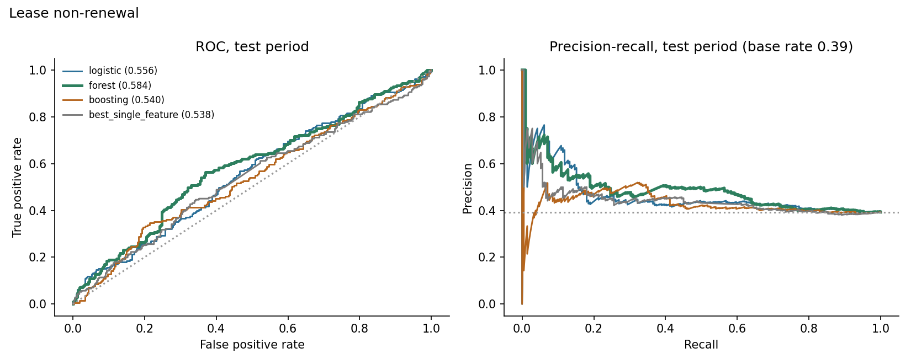
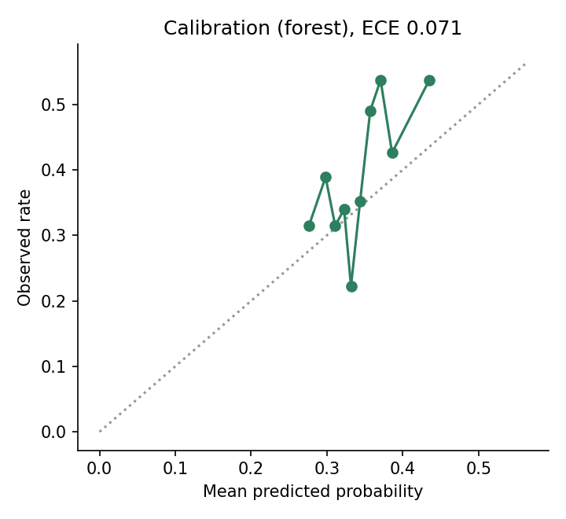
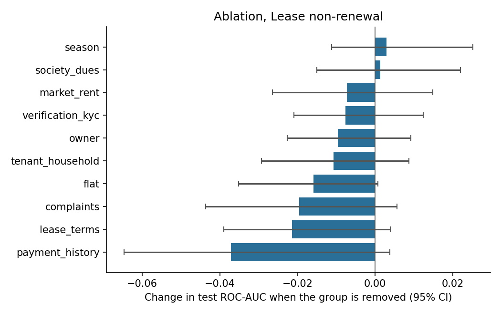
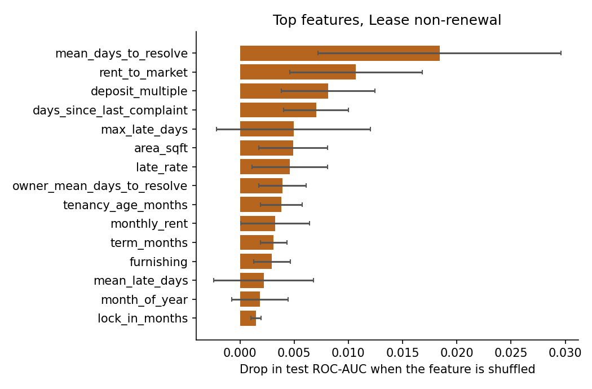

# Results: phase 8 models

All numbers come from the **test period only** (the last 20% of prediction dates), scored once, using models
tuned on the validation period and refit on train+valid. Brackets are 95% cluster-bootstrap intervals
(200 resamples of whole tenants or leases). The data is synthetic: these results describe the
simulator, not real tenants.

## M1: Lease non-renewal

Rows: train 1553, validation 480, test 538. Positive rate 0.383 overall, 0.392 in the test period. Primary model (best on validation): **forest**.

### Test results

| Model | ROC-AUC [95% CI] | PR-AUC [95% CI] | Brier | Precision in top 25% | Lift in top 25% |
|---|---|---|---|---|---|
| logistic | 0.556 [0.508, 0.605] | 0.462 [0.402, 0.530] | 0.243 | 0.437 | 1.11 |
| forest | 0.584 [0.541, 0.630] | 0.486 [0.430, 0.548] | 0.236 | 0.474 | 1.21 |
| boosting | 0.540 [0.489, 0.588] | 0.429 [0.379, 0.491] | 0.254 | 0.511 | 1.30 |
| prevalence | 0.500 | 0.379 | 0.239 |  |  |
| best_single_feature (mean_days_to_resolve) | 0.538 [0.496, 0.583] | 0.445 [0.391, 0.512] |  | 0.430 | 1.10 |

Gain of the primary model over the best single feature (`mean_days_to_resolve`): ROC-AUC +0.046 [-0.012, +0.094], PR-AUC +0.040 [-0.019, +0.093]. For ROC-AUC the interval includes zero; for PR-AUC it includes zero (a gain that is not clearly different from zero).

Calibration (expected calibration error): 0.071.

### Which feature groups matter (ablation)

Change in test ROC-AUC when a group is removed (same hyperparameters, refit), and the AUC when only that group is used.

| Group | Features | Change if removed [95% CI] | AUC using only this group |
|---|---|---|---|
| payment_history | 10 | -0.037 [-0.065, +0.004] | 0.512 |
| lease_terms | 10 | -0.021 [-0.039, +0.004] | 0.521 |
| complaints | 10 | -0.020 [-0.044, +0.006] | 0.548 |
| flat | 4 | -0.016 [-0.035, +0.001] | 0.500 |
| tenant_household | 6 | -0.011 [-0.029, +0.009] | 0.533 |
| owner | 5 | -0.010 [-0.023, +0.009] | 0.505 |
| verification_kyc | 3 | -0.008 [-0.021, +0.012] | 0.476 |
| market_rent | 3 | -0.007 [-0.026, +0.015] | 0.488 |
| society_dues | 3 | +0.001 [-0.015, +0.022] | 0.491 |
| season | 1 | +0.003 [-0.011, +0.025] | 0.520 |

### Permutation importance (primary model)

| Feature | Drop in test score when shuffled |
|---|---|
| mean_days_to_resolve | 0.0184 (sd 0.0112) |
| rent_to_market | 0.0107 (sd 0.0061) |
| deposit_multiple | 0.0081 (sd 0.0043) |
| days_since_last_complaint | 0.0070 (sd 0.0030) |
| max_late_days | 0.0049 (sd 0.0071) |
| area_sqft | 0.0049 (sd 0.0032) |
| late_rate | 0.0046 (sd 0.0035) |
| owner_mean_days_to_resolve | 0.0039 (sd 0.0022) |
| tenancy_age_months | 0.0038 (sd 0.0019) |
| monthly_rent | 0.0032 (sd 0.0032) |

### Do the predictions track the simulator's hidden traits? (diagnostic only)

- spearman prediction vs hidden final satisfaction: -0.153
- oracle auc knowing hidden final satisfaction: 0.546
- oracle auc knowing hidden initial satisfaction: 0.575
- model auc: 0.584

The oracle AUC is what a scorer that knew the hidden trait exactly would reach on the same test rows. It shows how much headroom the data leaves.

### Chosen hyperparameters (selected on validation only)

- logistic: {'C': 0.1}, validation auc 0.5066
- forest: {'leaf': 20}, validation auc 0.5237
- boosting: {'depth': 3, 'lr': 0.06, 'iters': 300, 'l2': 5.0}, validation auc 0.5122
