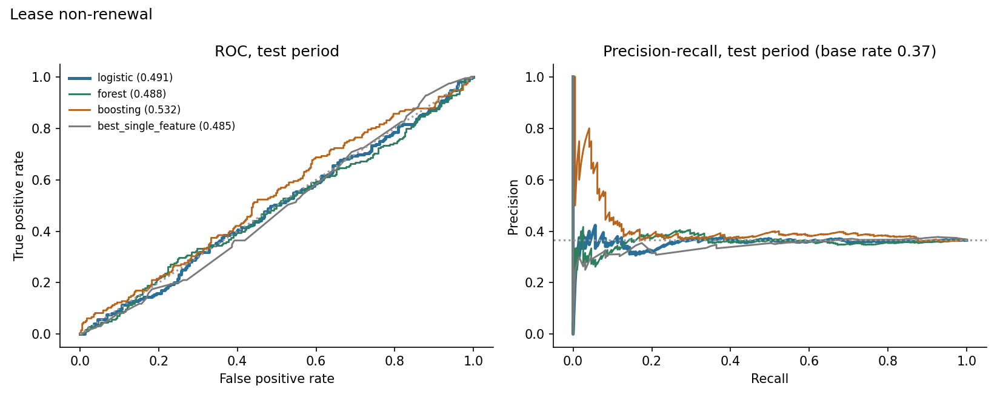
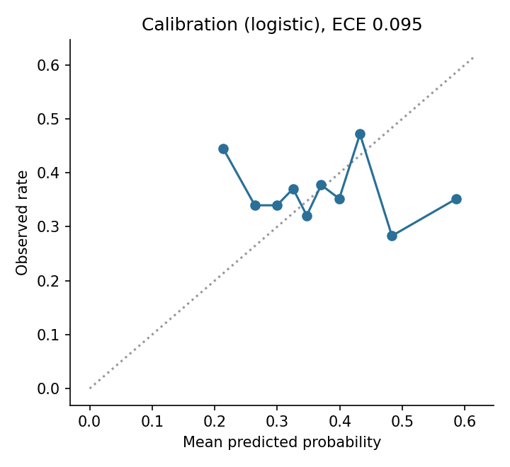
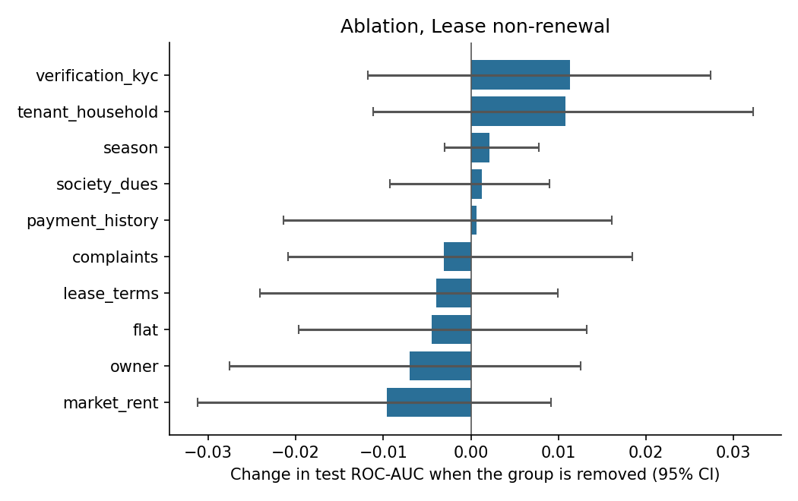
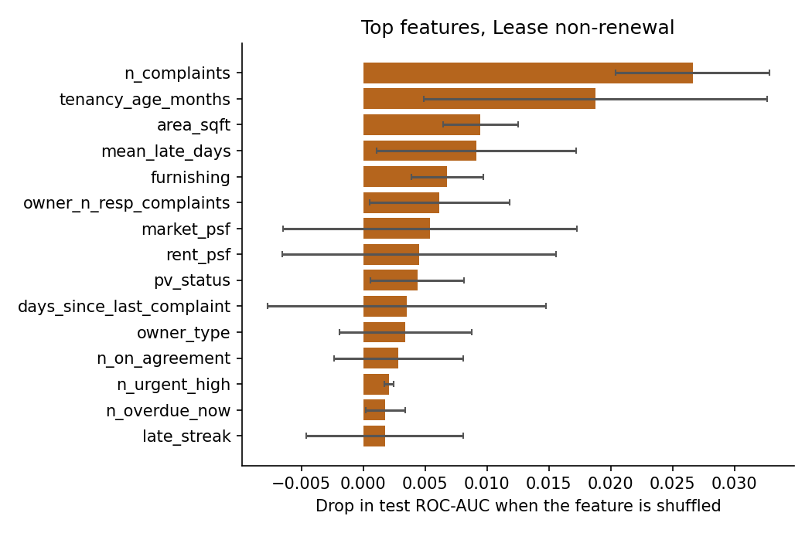

# Results: phase 8 models

All numbers come from the **test period only** (the last 20% of prediction dates), scored once, using models
tuned on the validation period and refit on train+valid. Brackets are 95% cluster-bootstrap intervals
(200 resamples of whole tenants or leases). The data is synthetic: these results describe the
simulator, not real tenants.

## M1: Lease non-renewal

Rows: train 1526, validation 476, test 534. Positive rate 0.371 overall, 0.365 in the test period. Primary model (best on validation): **logistic**.

### Test results

| Model | ROC-AUC [95% CI] | PR-AUC [95% CI] | Brier | Precision in top 25% | Lift in top 25% |
|---|---|---|---|---|---|
| logistic | 0.491 [0.443, 0.547] | 0.360 [0.316, 0.428] | 0.245 | 0.351 | 0.96 |
| forest | 0.488 [0.442, 0.534] | 0.361 [0.318, 0.421] | 0.233 | 0.396 | 1.08 |
| boosting | 0.532 [0.487, 0.580] | 0.410 [0.352, 0.485] | 0.232 | 0.388 | 1.06 |
| prevalence | 0.500 | 0.373 | 0.232 |  |  |
| best_single_feature (owner_past_renewal_rate) | 0.485 [0.431, 0.539] | 0.350 [0.312, 0.405] |  | 0.313 | 0.86 |

Gain of the primary model over the best single feature (`owner_past_renewal_rate`): ROC-AUC +0.005 [-0.065, +0.069], PR-AUC +0.011 [-0.041, +0.062]. For ROC-AUC the interval includes zero; for PR-AUC it includes zero (a gain that is not clearly different from zero).

Calibration (expected calibration error): 0.095.

### Which feature groups matter (ablation)

Change in test ROC-AUC when a group is removed (same hyperparameters, refit), and the AUC when only that group is used.

| Group | Features | Change if removed [95% CI] | AUC using only this group |
|---|---|---|---|
| market_rent | 3 | -0.010 [-0.031, +0.009] | 0.494 |
| owner | 5 | -0.007 [-0.028, +0.012] | 0.489 |
| flat | 4 | -0.004 [-0.020, +0.013] | 0.498 |
| lease_terms | 10 | -0.004 [-0.024, +0.010] | 0.497 |
| complaints | 10 | -0.003 [-0.021, +0.018] | 0.496 |
| payment_history | 10 | +0.001 [-0.021, +0.016] | 0.513 |
| society_dues | 3 | +0.001 [-0.009, +0.009] | 0.515 |
| season | 1 | +0.002 [-0.003, +0.008] | 0.437 |
| tenant_household | 6 | +0.011 [-0.011, +0.032] | 0.472 |
| verification_kyc | 3 | +0.011 [-0.012, +0.027] | 0.495 |

### Permutation importance (primary model)

| Feature | Drop in test score when shuffled |
|---|---|
| n_complaints | 0.0266 (sd 0.0062) |
| tenancy_age_months | 0.0188 (sd 0.0139) |
| area_sqft | 0.0095 (sd 0.0030) |
| mean_late_days | 0.0091 (sd 0.0081) |
| furnishing | 0.0068 (sd 0.0029) |
| owner_n_resp_complaints | 0.0062 (sd 0.0057) |
| market_psf | 0.0054 (sd 0.0119) |
| rent_psf | 0.0045 (sd 0.0111) |
| pv_status | 0.0044 (sd 0.0038) |
| days_since_last_complaint | 0.0035 (sd 0.0113) |

### Do the predictions track the simulator's hidden traits? (diagnostic only)

- spearman prediction vs hidden final satisfaction: -0.116
- oracle auc knowing hidden final satisfaction: 0.575
- oracle auc knowing hidden initial satisfaction: 0.594
- model auc: 0.491

The oracle AUC is what a scorer that knew the hidden trait exactly would reach on the same test rows. It shows how much headroom the data leaves.

### Chosen hyperparameters (selected on validation only)

- logistic: {'C': 1.0}, validation auc 0.5319
- forest: {'leaf': 50}, validation auc 0.5269
- boosting: {'depth': 2, 'lr': 0.03, 'iters': 150, 'l2': 0.0}, validation auc 0.5045
