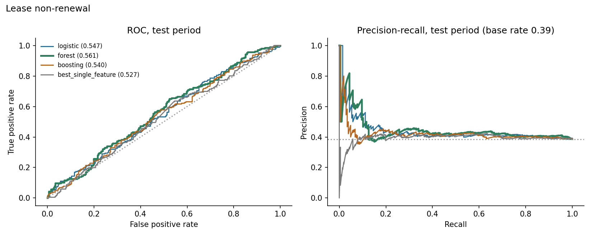
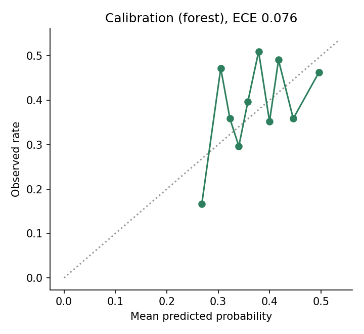
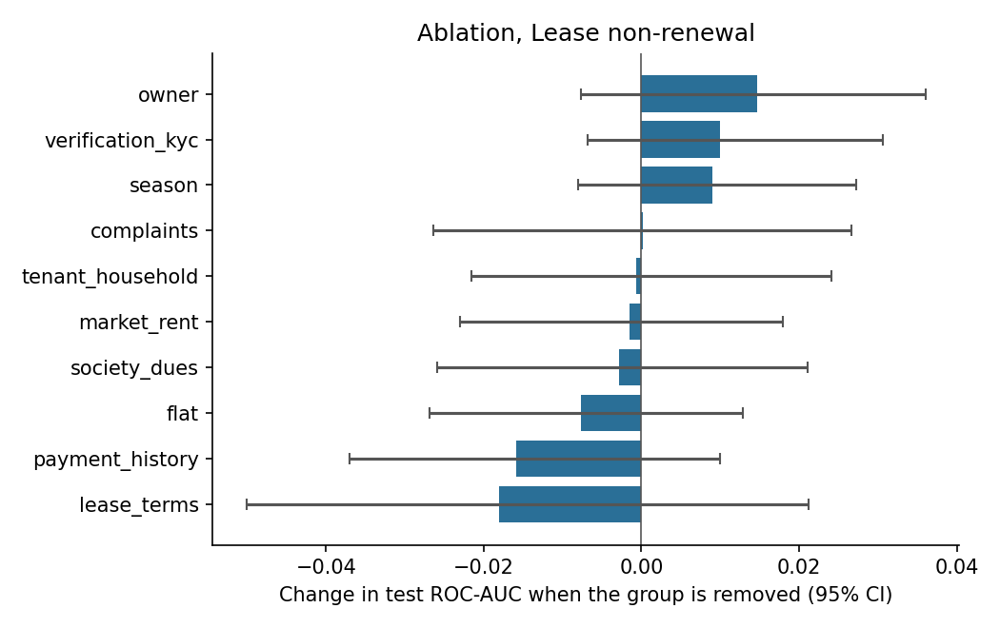
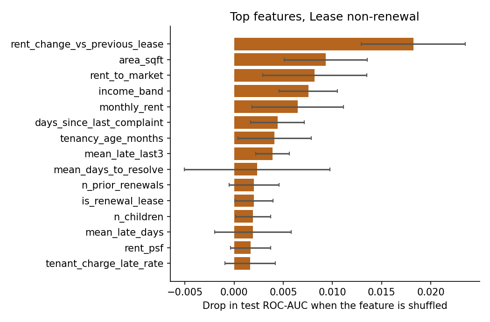
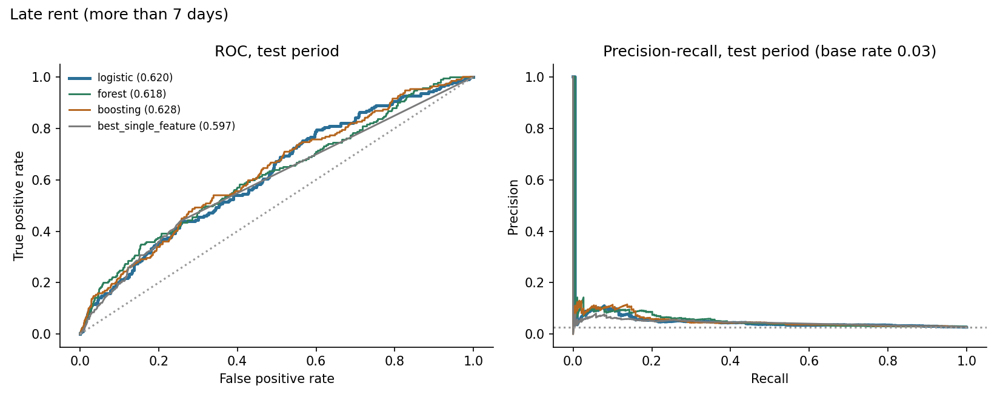
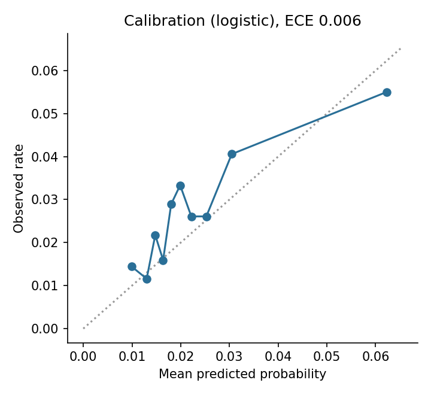
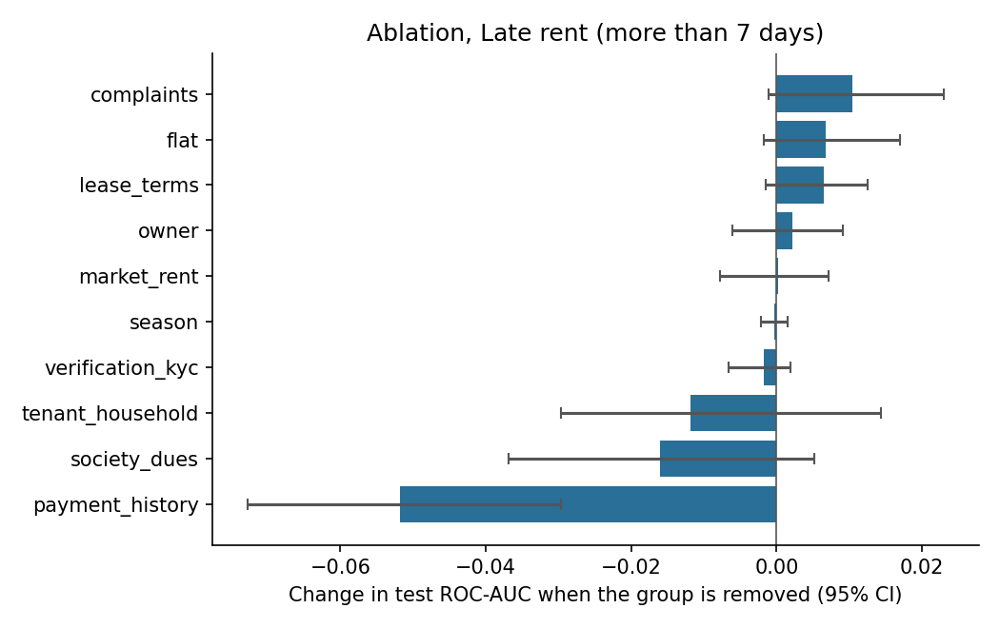
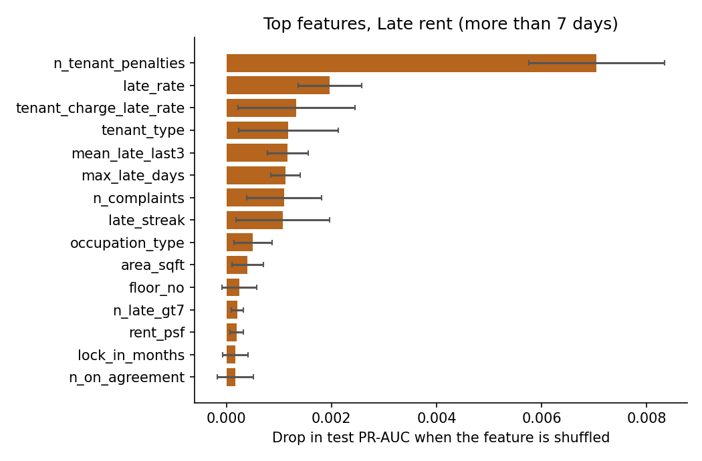

# Results: phase 8 models

All numbers come from the **test period only** (the last 20% of prediction dates), scored once, using models
tuned on the validation period and refit on train+valid. Brackets are 95% cluster-bootstrap intervals
(200 resamples of whole tenants or leases). The data is synthetic: these results describe the
simulator, not real tenants.

## M1: Lease non-renewal

Rows: train 1543, validation 468, test 534. Positive rate 0.389 overall, 0.386 in the test period. Primary model (best on validation): **forest**.

### Test results

| Model | ROC-AUC [95% CI] | PR-AUC [95% CI] | Brier | Precision in top 25% | Lift in top 25% |
|---|---|---|---|---|---|
| logistic | 0.547 [0.498, 0.598] | 0.442 [0.378, 0.505] | 0.238 | 0.425 | 1.10 |
| forest | 0.561 [0.512, 0.617] | 0.448 [0.392, 0.512] | 0.234 | 0.455 | 1.18 |
| boosting | 0.540 [0.491, 0.584] | 0.424 [0.372, 0.492] | 0.237 | 0.410 | 1.06 |
| prevalence | 0.500 | 0.389 | 0.237 |  |  |
| best_single_feature (mean_days_to_resolve) | 0.527 [0.471, 0.574] | 0.397 [0.345, 0.457] |  | 0.403 | 1.04 |

Gain of the primary model over the best single feature (`mean_days_to_resolve`): ROC-AUC +0.034 [-0.020, +0.086], PR-AUC +0.051 [-0.002, +0.099]. For ROC-AUC the interval includes zero; for PR-AUC it includes zero (a gain that is not clearly different from zero).

Calibration (expected calibration error): 0.076.

### Which feature groups matter (ablation)

Change in test ROC-AUC when a group is removed (same hyperparameters, refit), and the AUC when only that group is used.

| Group | Features | Change if removed [95% CI] | AUC using only this group |
|---|---|---|---|
| lease_terms | 10 | -0.018 [-0.050, +0.021] | 0.562 |
| payment_history | 10 | -0.016 [-0.037, +0.010] | 0.502 |
| flat | 4 | -0.008 [-0.027, +0.013] | 0.574 |
| society_dues | 3 | -0.003 [-0.026, +0.021] | 0.539 |
| market_rent | 3 | -0.002 [-0.023, +0.018] | 0.493 |
| tenant_household | 6 | -0.001 [-0.022, +0.024] | 0.527 |
| complaints | 10 | +0.000 [-0.026, +0.027] | 0.556 |
| season | 1 | +0.009 [-0.008, +0.027] | 0.478 |
| verification_kyc | 3 | +0.010 [-0.007, +0.031] | 0.533 |
| owner | 5 | +0.015 [-0.008, +0.036] | 0.497 |

### Permutation importance (primary model)

| Feature | Drop in test score when shuffled |
|---|---|
| rent_change_vs_previous_lease | 0.0182 (sd 0.0053) |
| area_sqft | 0.0093 (sd 0.0042) |
| rent_to_market | 0.0082 (sd 0.0053) |
| income_band | 0.0075 (sd 0.0029) |
| monthly_rent | 0.0065 (sd 0.0047) |
| days_since_last_complaint | 0.0044 (sd 0.0027) |
| tenancy_age_months | 0.0041 (sd 0.0037) |
| mean_late_last3 | 0.0039 (sd 0.0017) |
| mean_days_to_resolve | 0.0023 (sd 0.0074) |
| n_prior_renewals | 0.0020 (sd 0.0025) |

### Do the predictions track the simulator's hidden traits? (diagnostic only)

- spearman prediction vs hidden final satisfaction: -0.201
- oracle auc knowing hidden final satisfaction: 0.604
- oracle auc knowing hidden initial satisfaction: 0.657
- model auc: 0.561

The oracle AUC is what a scorer that knew the hidden trait exactly would reach on the same test rows. It shows how much headroom the data leaves.

### Chosen hyperparameters (selected on validation only)

- logistic: {'C': 0.01}, validation auc 0.5711
- forest: {'leaf': 5}, validation auc 0.5779
- boosting: {'depth': 2, 'lr': 0.03, 'iters': 150, 'l2': 5.0}, validation auc 0.5606

## M2: Late rent (more than 7 days)

Rows: train 20298, validation 6917, test 6903. Positive rate 0.028 overall, 0.027 in the test period. Primary model (best on validation): **logistic**.

### Test results

| Model | ROC-AUC [95% CI] | PR-AUC [95% CI] | Brier | Precision in top 10% | Lift in top 10% |
|---|---|---|---|---|---|
| logistic | 0.620 [0.577, 0.654] | 0.052 [0.036, 0.070] | 0.027 | 0.055 | 2.01 |
| forest | 0.618 [0.575, 0.654] | 0.057 [0.043, 0.077] | 0.026 | 0.065 | 2.38 |
| boosting | 0.628 [0.583, 0.666] | 0.052 [0.040, 0.070] | 0.026 | 0.059 | 2.17 |
| prevalence | 0.500 | 0.028 | 0.027 |  |  |
| best_single_feature (mean_late_days) | 0.597 [0.561, 0.627] | 0.040 [0.031, 0.055] |  | 0.054 | 1.96 |

Gain of the primary model over the best single feature (`mean_late_days`): ROC-AUC +0.021 [-0.017, +0.065], PR-AUC +0.011 [-0.002, +0.026]. For ROC-AUC the interval includes zero; for PR-AUC it includes zero (a gain that is not clearly different from zero).

Calibration (expected calibration error): 0.006.

### Which feature groups matter (ablation)

Change in test ROC-AUC when a group is removed (same hyperparameters, refit), and the AUC when only that group is used.

| Group | Features | Change if removed [95% CI] | AUC using only this group |
|---|---|---|---|
| payment_history | 10 | -0.052 [-0.073, -0.030] | 0.623 |
| society_dues | 3 | -0.016 [-0.037, +0.005] | 0.586 |
| tenant_household | 6 | -0.012 [-0.030, +0.014] | 0.562 |
| verification_kyc | 3 | -0.002 [-0.007, +0.002] | 0.493 |
| season | 1 | -0.000 [-0.002, +0.002] | 0.499 |
| market_rent | 3 | +0.000 [-0.008, +0.007] | 0.544 |
| owner | 5 | +0.002 [-0.006, +0.009] | 0.518 |
| lease_terms | 9 | +0.007 [-0.001, +0.013] | 0.528 |
| flat | 4 | +0.007 [-0.002, +0.017] | 0.485 |
| complaints | 10 | +0.010 [-0.001, +0.023] | 0.483 |

### Permutation importance (primary model)

| Feature | Drop in test score when shuffled |
|---|---|
| n_tenant_penalties | 0.0070 (sd 0.0013) |
| late_rate | 0.0020 (sd 0.0006) |
| tenant_charge_late_rate | 0.0013 (sd 0.0011) |
| tenant_type | 0.0012 (sd 0.0009) |
| mean_late_last3 | 0.0012 (sd 0.0004) |
| max_late_days | 0.0011 (sd 0.0003) |
| n_complaints | 0.0011 (sd 0.0007) |
| late_streak | 0.0011 (sd 0.0009) |
| occupation_type | 0.0005 (sd 0.0004) |
| area_sqft | 0.0004 (sd 0.0003) |

### Do the predictions track the simulator's hidden traits? (diagnostic only)

- spearman prediction vs hidden reliability: -0.307
- oracle auc knowing hidden reliability: 0.765
- model auc: 0.620

The oracle AUC is what a scorer that knew the hidden trait exactly would reach on the same test rows. It shows how much headroom the data leaves.

### Chosen hyperparameters (selected on validation only)

- logistic: {'C': 0.01}, validation ap 0.0586
- forest: {'leaf': 50}, validation ap 0.0524
- boosting: {'depth': 2, 'lr': 0.06, 'iters': 150, 'l2': 5.0}, validation ap 0.0573
