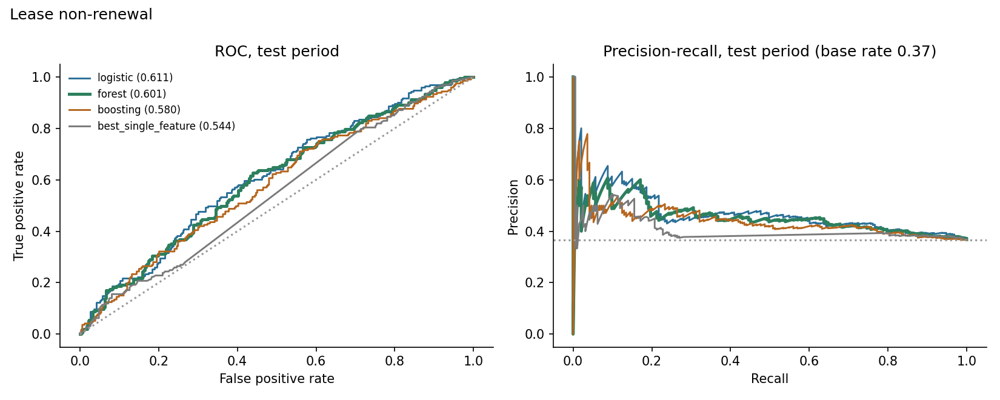
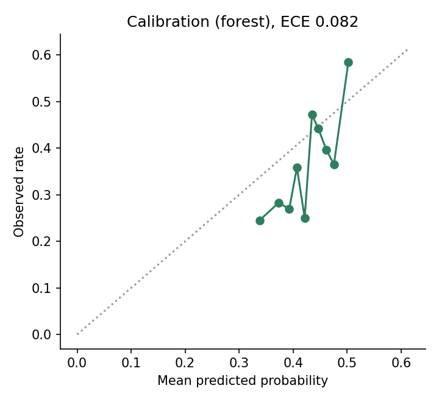
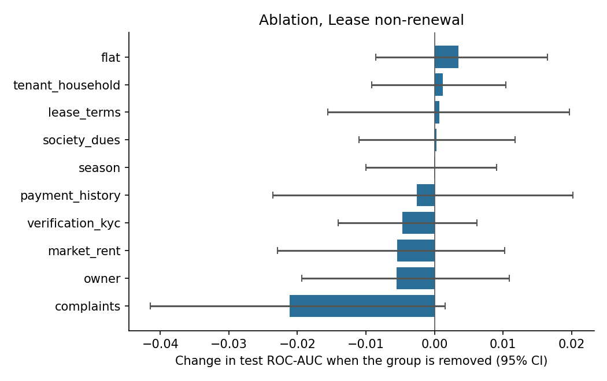
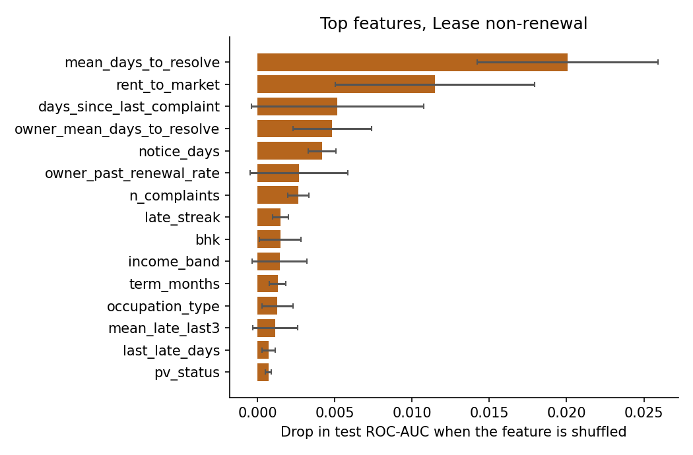
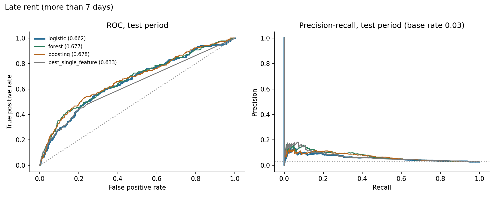
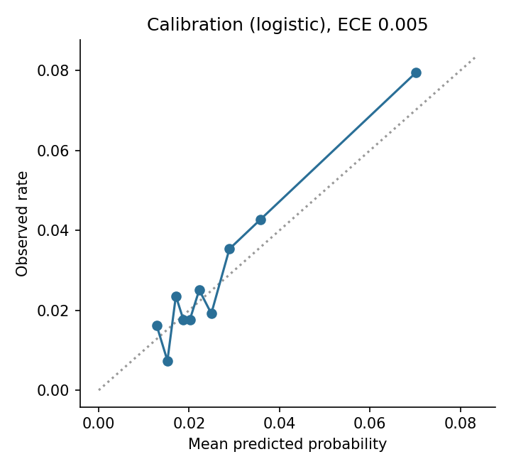
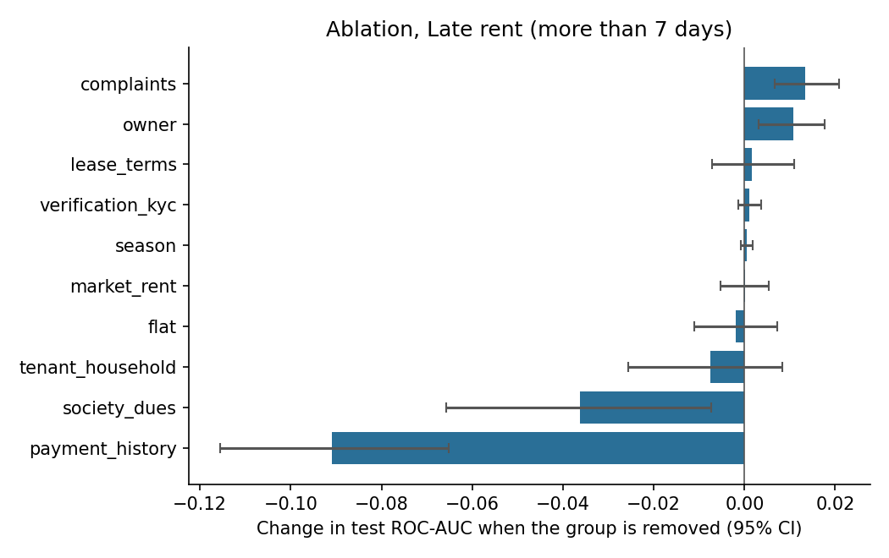
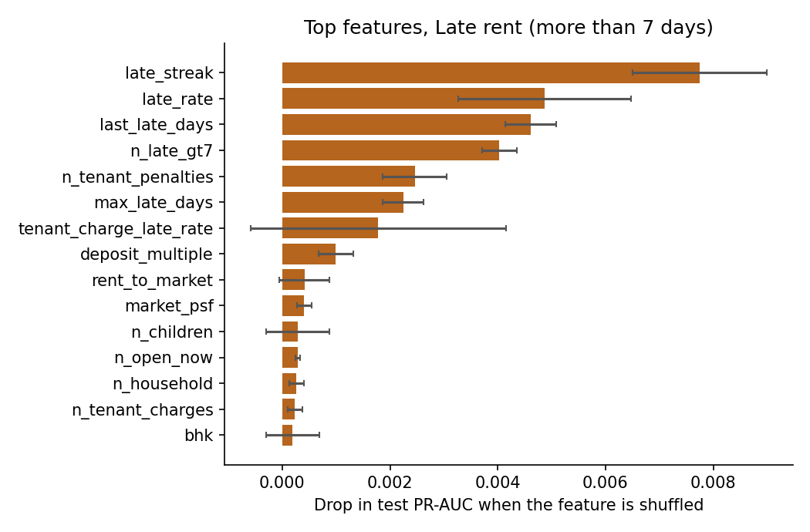

# Results: phase 8 models

All numbers come from the **test period only** (the last 20% of prediction dates), scored once, using models
tuned on the validation period and refit on train+valid. Brackets are 95% cluster-bootstrap intervals
(200 resamples of whole tenants or leases). The data is synthetic: these results describe the
simulator, not real tenants.

## M1: Lease non-renewal

Rows: train 1515, validation 480, test 526. Positive rate 0.397 overall, 0.367 in the test period. Primary model (best on validation): **forest**.

### Test results

| Model | ROC-AUC [95% CI] | PR-AUC [95% CI] | Brier | Precision in top 25% | Lift in top 25% |
|---|---|---|---|---|---|
| logistic | 0.611 [0.567, 0.672] | 0.470 [0.419, 0.549] | 0.231 | 0.455 | 1.24 |
| forest | 0.601 [0.554, 0.656] | 0.454 [0.397, 0.536] | 0.230 | 0.455 | 1.24 |
| boosting | 0.580 [0.532, 0.633] | 0.442 [0.388, 0.523] | 0.232 | 0.470 | 1.28 |
| prevalence | 0.500 | 0.405 | 0.234 |  |  |
| best_single_feature (rent_change_vs_previous_lease) | 0.544 [0.497, 0.589] | 0.412 [0.361, 0.478] |  | 0.379 | 1.03 |

Gain of the primary model over the best single feature (`rent_change_vs_previous_lease`): ROC-AUC +0.057 [-0.003, +0.119], PR-AUC +0.043 [-0.023, +0.103]. For ROC-AUC the interval includes zero; for PR-AUC it includes zero (a gain that is not clearly different from zero).

Calibration (expected calibration error): 0.082.

### Which feature groups matter (ablation)

Change in test ROC-AUC when a group is removed (same hyperparameters, refit), and the AUC when only that group is used.

| Group | Features | Change if removed [95% CI] | AUC using only this group |
|---|---|---|---|
| complaints | 10 | -0.021 [-0.041, +0.002] | 0.554 |
| owner | 5 | -0.006 [-0.019, +0.011] | 0.527 |
| market_rent | 3 | -0.005 [-0.023, +0.010] | 0.571 |
| verification_kyc | 3 | -0.005 [-0.014, +0.006] | 0.528 |
| payment_history | 10 | -0.003 [-0.024, +0.020] | 0.534 |
| season | 1 | -0.000 [-0.010, +0.009] | 0.504 |
| society_dues | 3 | +0.000 [-0.011, +0.012] | 0.491 |
| lease_terms | 10 | +0.001 [-0.016, +0.020] | 0.547 |
| tenant_household | 6 | +0.001 [-0.009, +0.010] | 0.544 |
| flat | 4 | +0.004 [-0.009, +0.016] | 0.487 |

### Permutation importance (primary model)

| Feature | Drop in test score when shuffled |
|---|---|
| mean_days_to_resolve | 0.0201 (sd 0.0058) |
| rent_to_market | 0.0115 (sd 0.0065) |
| days_since_last_complaint | 0.0052 (sd 0.0056) |
| owner_mean_days_to_resolve | 0.0048 (sd 0.0025) |
| notice_days | 0.0042 (sd 0.0009) |
| owner_past_renewal_rate | 0.0027 (sd 0.0031) |
| n_complaints | 0.0026 (sd 0.0007) |
| late_streak | 0.0015 (sd 0.0005) |
| bhk | 0.0015 (sd 0.0014) |
| income_band | 0.0014 (sd 0.0018) |

### Do the predictions track the simulator's hidden traits? (diagnostic only)

- spearman prediction vs hidden final satisfaction: -0.130
- oracle auc knowing hidden final satisfaction: 0.618
- oracle auc knowing hidden initial satisfaction: 0.642
- model auc: 0.601

The oracle AUC is what a scorer that knew the hidden trait exactly would reach on the same test rows. It shows how much headroom the data leaves.

### Chosen hyperparameters (selected on validation only)

- logistic: {'C': 1.0}, validation auc 0.5683
- forest: {'leaf': 50}, validation auc 0.5932
- boosting: {'depth': 2, 'lr': 0.03, 'iters': 150, 'l2': 5.0}, validation auc 0.5787

## M2: Late rent (more than 7 days)

Rows: train 19966, validation 6769, test 6785. Positive rate 0.028 overall, 0.028 in the test period. Primary model (best on validation): **logistic**.

### Test results

| Model | ROC-AUC [95% CI] | PR-AUC [95% CI] | Brier | Precision in top 10% | Lift in top 10% |
|---|---|---|---|---|---|
| logistic | 0.662 [0.616, 0.701] | 0.060 [0.044, 0.076] | 0.027 | 0.080 | 2.80 |
| forest | 0.677 [0.632, 0.712] | 0.073 [0.053, 0.098] | 0.027 | 0.099 | 3.47 |
| boosting | 0.678 [0.632, 0.715] | 0.069 [0.052, 0.091] | 0.027 | 0.091 | 3.21 |
| prevalence | 0.500 | 0.028 | 0.028 |  |  |
| best_single_feature (mean_late_days) | 0.633 [0.591, 0.665] | 0.062 [0.048, 0.080] |  | 0.078 | 2.74 |

Gain of the primary model over the best single feature (`mean_late_days`): ROC-AUC +0.028 [-0.015, +0.069], PR-AUC -0.002 [-0.014, +0.010]. For ROC-AUC the interval includes zero; for PR-AUC it includes zero (a gain that is not clearly different from zero).

Calibration (expected calibration error): 0.005.

### Which feature groups matter (ablation)

Change in test ROC-AUC when a group is removed (same hyperparameters, refit), and the AUC when only that group is used.

| Group | Features | Change if removed [95% CI] | AUC using only this group |
|---|---|---|---|
| payment_history | 10 | -0.091 [-0.116, -0.065] | 0.662 |
| society_dues | 3 | -0.036 [-0.066, -0.007] | 0.570 |
| tenant_household | 6 | -0.008 [-0.026, +0.008] | 0.526 |
| flat | 4 | -0.002 [-0.011, +0.007] | 0.523 |
| market_rent | 3 | +0.000 [-0.005, +0.005] | 0.452 |
| season | 1 | +0.000 [-0.001, +0.002] | 0.506 |
| verification_kyc | 3 | +0.001 [-0.001, +0.004] | 0.518 |
| lease_terms | 9 | +0.002 [-0.007, +0.011] | 0.514 |
| owner | 5 | +0.011 [+0.003, +0.018] | 0.451 |
| complaints | 10 | +0.013 [+0.007, +0.021] | 0.444 |

### Permutation importance (primary model)

| Feature | Drop in test score when shuffled |
|---|---|
| late_streak | 0.0077 (sd 0.0012) |
| late_rate | 0.0049 (sd 0.0016) |
| last_late_days | 0.0046 (sd 0.0005) |
| n_late_gt7 | 0.0040 (sd 0.0003) |
| n_tenant_penalties | 0.0025 (sd 0.0006) |
| max_late_days | 0.0022 (sd 0.0004) |
| tenant_charge_late_rate | 0.0018 (sd 0.0024) |
| deposit_multiple | 0.0010 (sd 0.0003) |
| rent_to_market | 0.0004 (sd 0.0005) |
| market_psf | 0.0004 (sd 0.0001) |

### Do the predictions track the simulator's hidden traits? (diagnostic only)

- spearman prediction vs hidden reliability: -0.447
- oracle auc knowing hidden reliability: 0.773
- model auc: 0.662

The oracle AUC is what a scorer that knew the hidden trait exactly would reach on the same test rows. It shows how much headroom the data leaves.

### Chosen hyperparameters (selected on validation only)

- logistic: {'C': 0.01}, validation ap 0.0762
- forest: {'leaf': 50}, validation ap 0.0731
- boosting: {'depth': 2, 'lr': 0.03, 'iters': 150, 'l2': 5.0}, validation ap 0.0732
