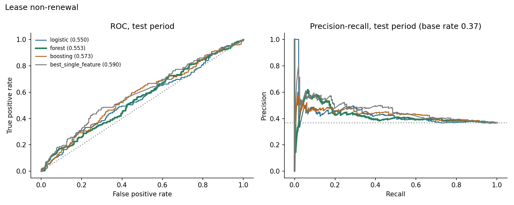
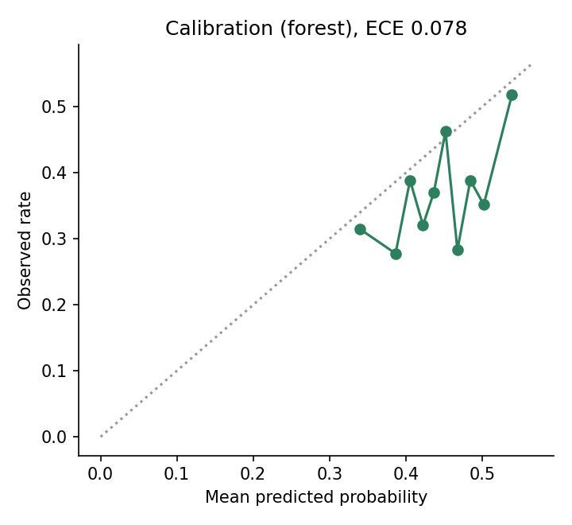
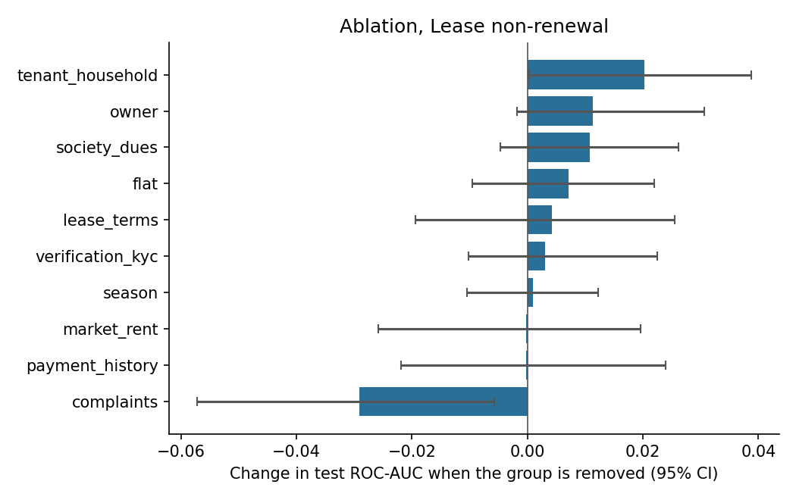
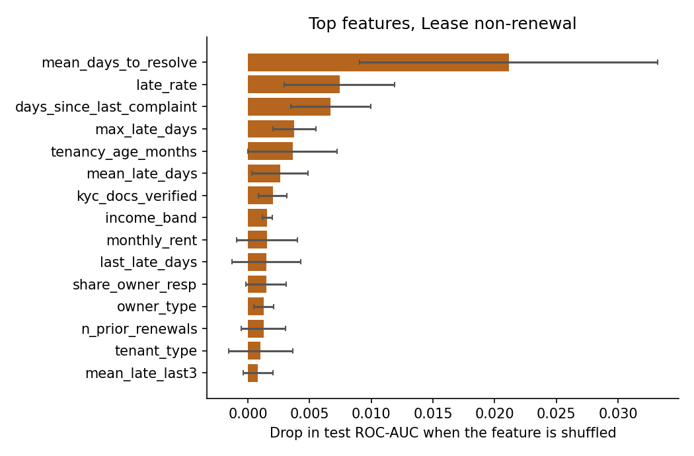
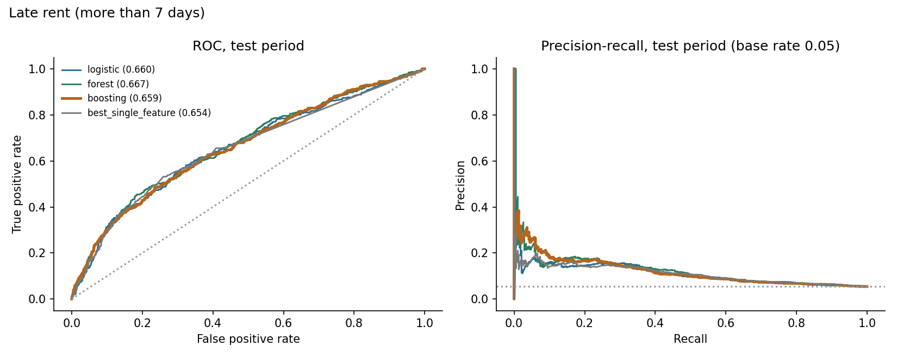
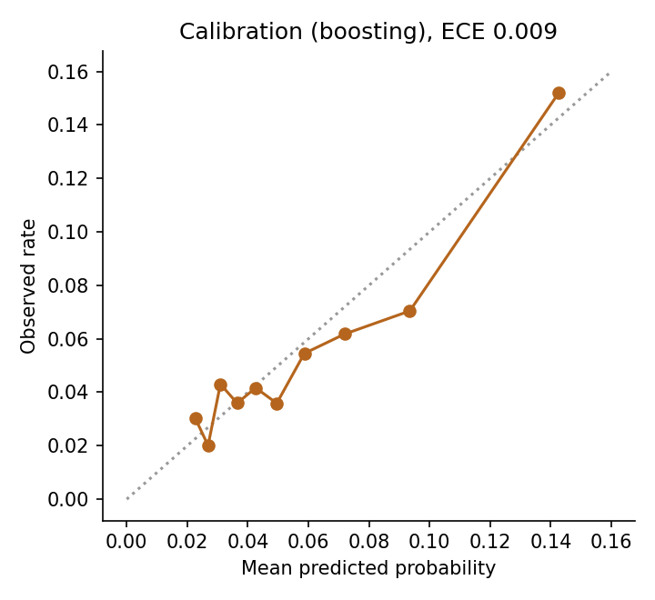
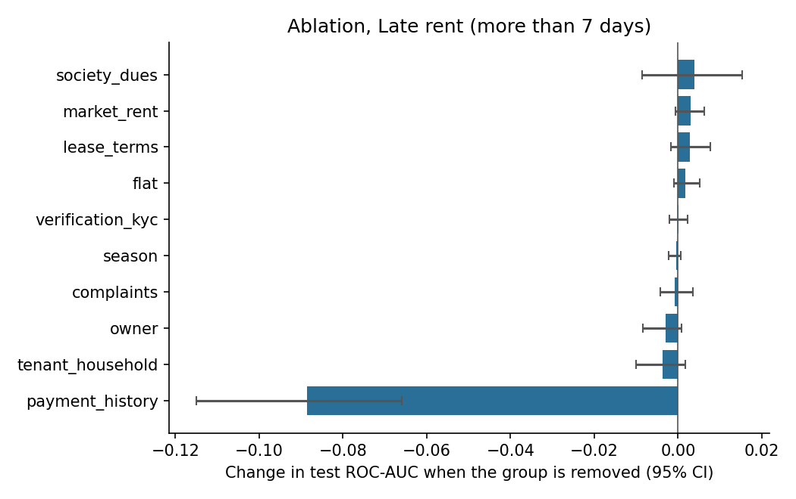
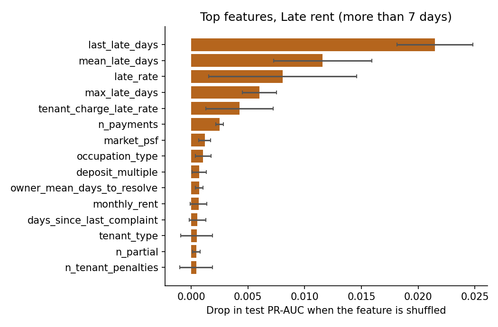

# Results: phase 8 models

All numbers come from the **test period only** (the last 20% of prediction dates), scored once, using models
tuned on the validation period and refit on train+valid. Brackets are 95% cluster-bootstrap intervals
(200 resamples of whole tenants or leases). The data is synthetic: these results describe the
simulator, not real tenants.

## M1: Lease non-renewal

Rows: train 1497, validation 466, test 538. Positive rate 0.418 overall, 0.368 in the test period. Primary model (best on validation): **forest**.

### Test results

| Model | ROC-AUC [95% CI] | PR-AUC [95% CI] | Brier | Precision in top 25% | Lift in top 25% |
|---|---|---|---|---|---|
| logistic | 0.550 [0.504, 0.595] | 0.427 [0.372, 0.503] | 0.240 | 0.467 | 1.27 |
| forest | 0.553 [0.502, 0.602] | 0.423 [0.372, 0.490] | 0.237 | 0.437 | 1.19 |
| boosting | 0.573 [0.526, 0.631] | 0.432 [0.379, 0.505] | 0.236 | 0.452 | 1.23 |
| prevalence | 0.500 | 0.429 | 0.236 |  |  |
| best_single_feature (mean_days_to_resolve) | 0.590 [0.548, 0.641] | 0.461 [0.401, 0.532] |  | 0.481 | 1.31 |

Gain of the primary model over the best single feature (`mean_days_to_resolve`): ROC-AUC -0.039 [-0.086, +0.011], PR-AUC -0.040 [-0.093, +0.021]. For ROC-AUC the interval includes zero; for PR-AUC it includes zero (a gain that is not clearly different from zero).

Calibration (expected calibration error): 0.078.

### Which feature groups matter (ablation)

Change in test ROC-AUC when a group is removed (same hyperparameters, refit), and the AUC when only that group is used.

| Group | Features | Change if removed [95% CI] | AUC using only this group |
|---|---|---|---|
| complaints | 10 | -0.029 [-0.057, -0.006] | 0.584 |
| payment_history | 10 | -0.000 [-0.022, +0.024] | 0.547 |
| market_rent | 3 | -0.000 [-0.026, +0.020] | 0.469 |
| season | 1 | +0.001 [-0.010, +0.012] | 0.520 |
| verification_kyc | 3 | +0.003 [-0.010, +0.023] | 0.506 |
| lease_terms | 10 | +0.004 [-0.019, +0.025] | 0.512 |
| flat | 4 | +0.007 [-0.010, +0.022] | 0.508 |
| society_dues | 3 | +0.011 [-0.005, +0.026] | 0.462 |
| owner | 5 | +0.011 [-0.002, +0.031] | 0.471 |
| tenant_household | 6 | +0.020 [+0.000, +0.039] | 0.526 |

### Permutation importance (primary model)

| Feature | Drop in test score when shuffled |
|---|---|
| mean_days_to_resolve | 0.0211 (sd 0.0121) |
| late_rate | 0.0074 (sd 0.0045) |
| days_since_last_complaint | 0.0067 (sd 0.0032) |
| max_late_days | 0.0038 (sd 0.0017) |
| tenancy_age_months | 0.0036 (sd 0.0036) |
| mean_late_days | 0.0026 (sd 0.0023) |
| kyc_docs_verified | 0.0020 (sd 0.0011) |
| income_band | 0.0016 (sd 0.0004) |
| monthly_rent | 0.0015 (sd 0.0025) |
| last_late_days | 0.0015 (sd 0.0028) |

### Do the predictions track the simulator's hidden traits? (diagnostic only)

- spearman prediction vs hidden final satisfaction: -0.104
- oracle auc knowing hidden final satisfaction: 0.671
- oracle auc knowing hidden initial satisfaction: 0.674
- model auc: 0.553

The oracle AUC is what a scorer that knew the hidden trait exactly would reach on the same test rows. It shows how much headroom the data leaves.

### Chosen hyperparameters (selected on validation only)

- logistic: {'C': 0.01}, validation auc 0.6001
- forest: {'leaf': 20}, validation auc 0.6008
- boosting: {'depth': 3, 'lr': 0.03, 'iters': 150, 'l2': 5.0}, validation auc 0.5789

## M2: Late rent (more than 7 days)

Rows: train 20158, validation 6858, test 6966. Positive rate 0.052 overall, 0.055 in the test period. Primary model (best on validation): **boosting**.

### Test results

| Model | ROC-AUC [95% CI] | PR-AUC [95% CI] | Brier | Precision in top 10% | Lift in top 10% |
|---|---|---|---|---|---|
| logistic | 0.660 [0.628, 0.688] | 0.111 [0.093, 0.131] | 0.051 | 0.156 | 2.87 |
| forest | 0.667 [0.643, 0.696] | 0.123 [0.101, 0.148] | 0.050 | 0.152 | 2.79 |
| boosting | 0.659 [0.632, 0.684] | 0.120 [0.098, 0.143] | 0.050 | 0.152 | 2.79 |
| prevalence | 0.500 | 0.051 | 0.052 |  |  |
| best_single_feature (mean_late_days) | 0.654 [0.629, 0.676] | 0.105 [0.088, 0.123] |  | 0.148 | 2.71 |

Gain of the primary model over the best single feature (`mean_late_days`): ROC-AUC +0.006 [-0.013, +0.025], PR-AUC +0.016 [+0.000, +0.032]. For ROC-AUC the interval includes zero; for PR-AUC it excludes zero (a gain that is not clearly different from zero).

Calibration (expected calibration error): 0.009.

### Which feature groups matter (ablation)

Change in test ROC-AUC when a group is removed (same hyperparameters, refit), and the AUC when only that group is used.

| Group | Features | Change if removed [95% CI] | AUC using only this group |
|---|---|---|---|
| payment_history | 10 | -0.089 [-0.115, -0.066] | 0.675 |
| tenant_household | 6 | -0.004 [-0.010, +0.002] | 0.585 |
| owner | 5 | -0.003 [-0.008, +0.001] | 0.538 |
| complaints | 10 | -0.001 [-0.004, +0.004] | 0.496 |
| season | 1 | -0.000 [-0.002, +0.001] | 0.505 |
| verification_kyc | 3 | +0.000 [-0.002, +0.002] | 0.516 |
| flat | 4 | +0.002 [-0.001, +0.005] | 0.493 |
| lease_terms | 9 | +0.003 [-0.002, +0.008] | 0.490 |
| market_rent | 3 | +0.003 [-0.001, +0.006] | 0.510 |
| society_dues | 3 | +0.004 [-0.009, +0.015] | 0.542 |

### Permutation importance (primary model)

| Feature | Drop in test score when shuffled |
|---|---|
| last_late_days | 0.0215 (sd 0.0033) |
| mean_late_days | 0.0116 (sd 0.0043) |
| late_rate | 0.0081 (sd 0.0065) |
| max_late_days | 0.0060 (sd 0.0015) |
| tenant_charge_late_rate | 0.0043 (sd 0.0030) |
| n_payments | 0.0025 (sd 0.0003) |
| market_psf | 0.0012 (sd 0.0005) |
| occupation_type | 0.0010 (sd 0.0007) |
| deposit_multiple | 0.0007 (sd 0.0006) |
| owner_mean_days_to_resolve | 0.0007 (sd 0.0003) |

### Do the predictions track the simulator's hidden traits? (diagnostic only)

- spearman prediction vs hidden reliability: -0.527
- oracle auc knowing hidden reliability: 0.764
- model auc: 0.659

The oracle AUC is what a scorer that knew the hidden trait exactly would reach on the same test rows. It shows how much headroom the data leaves.

### Chosen hyperparameters (selected on validation only)

- logistic: {'C': 0.01}, validation ap 0.0963
- forest: {'leaf': 50}, validation ap 0.1035
- boosting: {'depth': 2, 'lr': 0.06, 'iters': 150, 'l2': 5.0}, validation ap 0.1084
