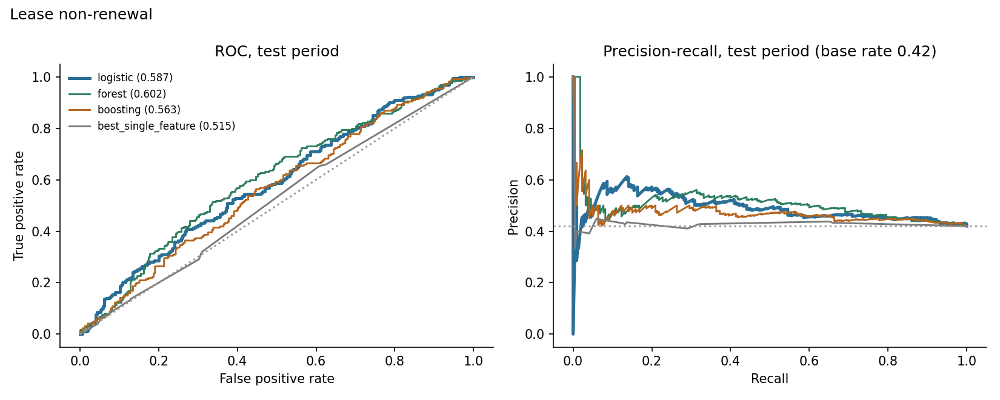
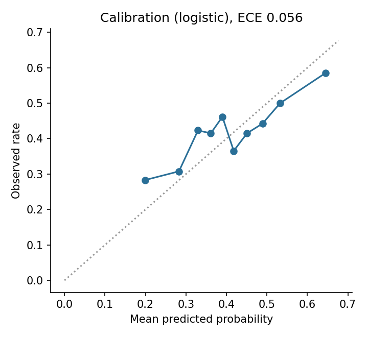
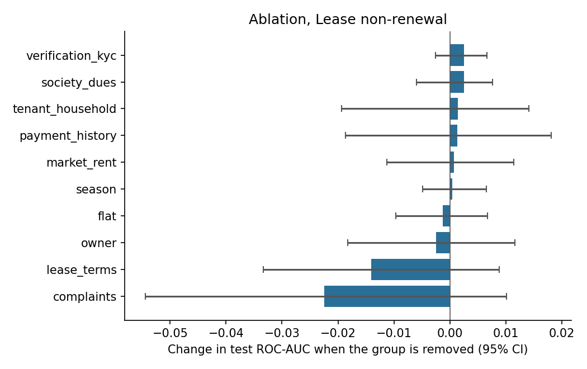
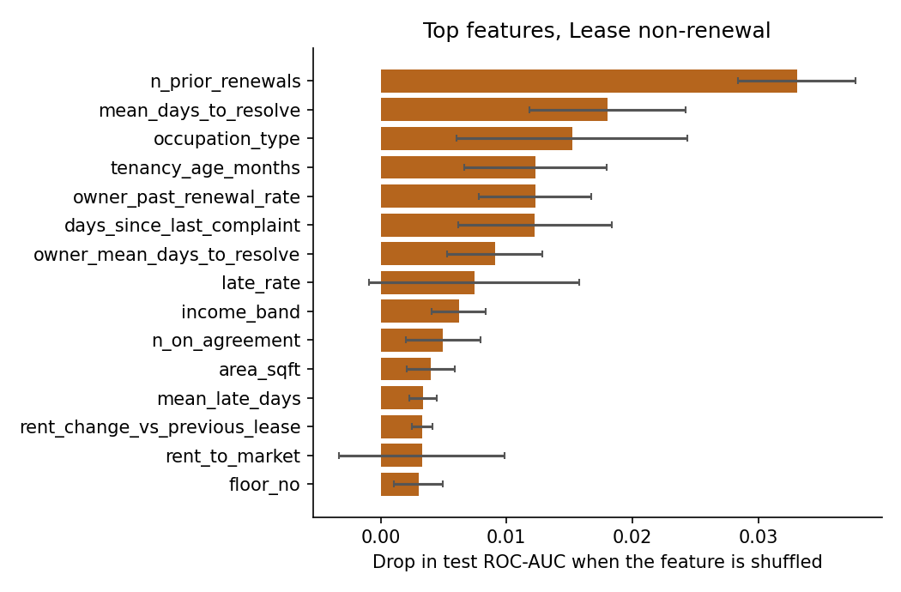
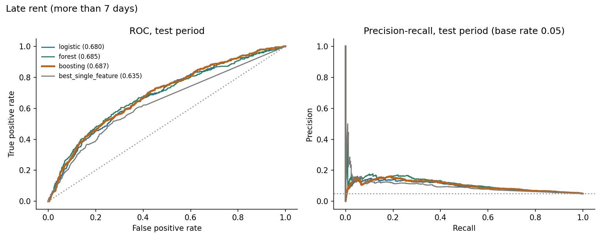
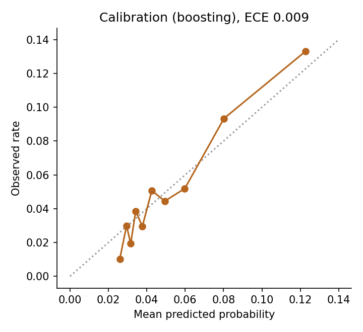
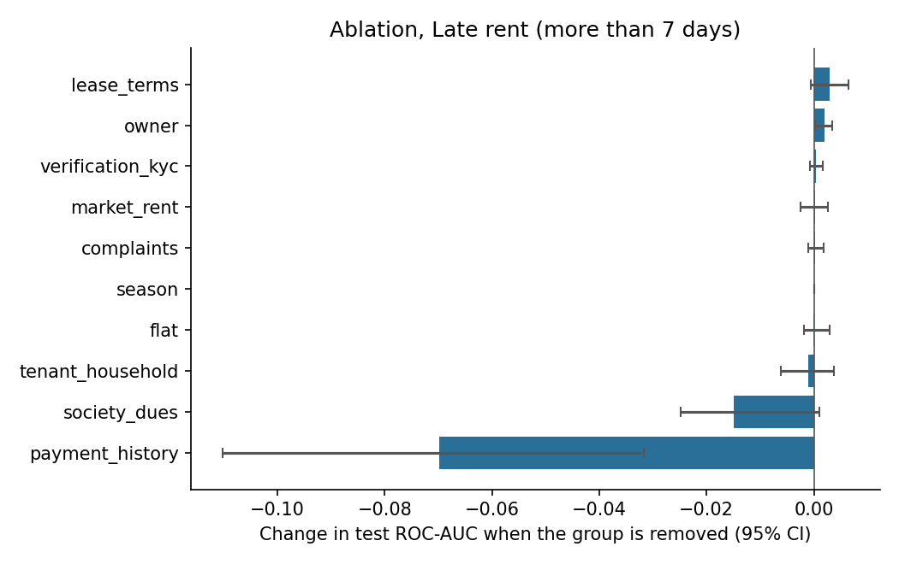
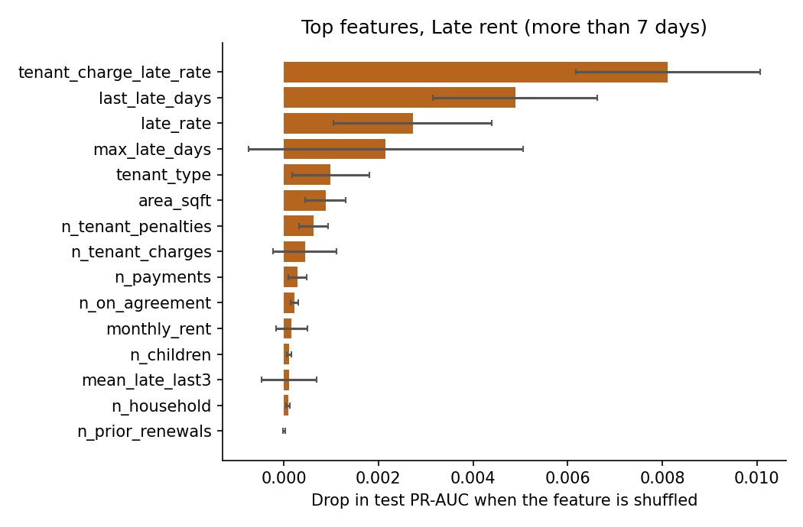

# Results: phase 8 models

All numbers come from the **test period only** (the last 20% of prediction dates), scored once, using models
tuned on the validation period and refit on train+valid. Brackets are 95% cluster-bootstrap intervals
(200 resamples of whole tenants or leases). The data is synthetic: these results describe the
simulator, not real tenants.

## M1: Lease non-renewal

Rows: train 1513, validation 451, test 524. Positive rate 0.412 overall, 0.420 in the test period. Primary model (best on validation): **logistic**.

### Test results

| Model | ROC-AUC [95% CI] | PR-AUC [95% CI] | Brier | Precision in top 25% | Lift in top 25% |
|---|---|---|---|---|---|
| logistic | 0.587 [0.541, 0.642] | 0.491 [0.430, 0.566] | 0.241 | 0.519 | 1.24 |
| forest | 0.602 [0.558, 0.662] | 0.505 [0.438, 0.592] | 0.238 | 0.542 | 1.29 |
| boosting | 0.563 [0.511, 0.619] | 0.472 [0.410, 0.549] | 0.241 | 0.496 | 1.18 |
| prevalence | 0.500 | 0.410 | 0.244 |  |  |
| best_single_feature (late_rate) | 0.515 [0.460, 0.563] | 0.425 [0.367, 0.486] |  | 0.389 | 0.93 |

Gain of the primary model over the best single feature (`late_rate`): ROC-AUC +0.070 [+0.008, +0.130], PR-AUC +0.066 [+0.018, +0.126]. For ROC-AUC the interval excludes zero; for PR-AUC it excludes zero.

Calibration (expected calibration error): 0.056.

### Which feature groups matter (ablation)

Change in test ROC-AUC when a group is removed (same hyperparameters, refit), and the AUC when only that group is used.

| Group | Features | Change if removed [95% CI] | AUC using only this group |
|---|---|---|---|
| complaints | 10 | -0.022 [-0.054, +0.010] | 0.573 |
| lease_terms | 10 | -0.014 [-0.033, +0.009] | 0.567 |
| owner | 5 | -0.002 [-0.018, +0.012] | 0.570 |
| flat | 4 | -0.001 [-0.010, +0.007] | 0.553 |
| season | 1 | +0.000 [-0.005, +0.007] | 0.500 |
| market_rent | 3 | +0.001 [-0.011, +0.011] | 0.518 |
| payment_history | 10 | +0.001 [-0.019, +0.018] | 0.512 |
| tenant_household | 6 | +0.001 [-0.019, +0.014] | 0.528 |
| society_dues | 3 | +0.002 [-0.006, +0.008] | 0.521 |
| verification_kyc | 3 | +0.003 [-0.003, +0.007] | 0.516 |

### Permutation importance (primary model)

| Feature | Drop in test score when shuffled |
|---|---|
| n_prior_renewals | 0.0331 (sd 0.0047) |
| mean_days_to_resolve | 0.0180 (sd 0.0062) |
| occupation_type | 0.0152 (sd 0.0092) |
| tenancy_age_months | 0.0123 (sd 0.0057) |
| owner_past_renewal_rate | 0.0123 (sd 0.0045) |
| days_since_last_complaint | 0.0123 (sd 0.0061) |
| owner_mean_days_to_resolve | 0.0091 (sd 0.0038) |
| late_rate | 0.0074 (sd 0.0084) |
| income_band | 0.0062 (sd 0.0022) |
| n_on_agreement | 0.0050 (sd 0.0030) |

### Do the predictions track the simulator's hidden traits? (diagnostic only)

- spearman prediction vs hidden final satisfaction: -0.149
- oracle auc knowing hidden final satisfaction: 0.604
- oracle auc knowing hidden initial satisfaction: 0.638
- model auc: 0.587

The oracle AUC is what a scorer that knew the hidden trait exactly would reach on the same test rows. It shows how much headroom the data leaves.

### Chosen hyperparameters (selected on validation only)

- logistic: {'C': 0.1}, validation auc 0.5697
- forest: {'leaf': 50}, validation auc 0.5496
- boosting: {'depth': 2, 'lr': 0.03, 'iters': 150, 'l2': 5.0}, validation auc 0.5562

## M2: Late rent (more than 7 days)

Rows: train 20044, validation 6875, test 6753. Positive rate 0.053 overall, 0.050 in the test period. Primary model (best on validation): **boosting**.

### Test results

| Model | ROC-AUC [95% CI] | PR-AUC [95% CI] | Brier | Precision in top 10% | Lift in top 10% |
|---|---|---|---|---|---|
| logistic | 0.680 [0.644, 0.709] | 0.101 [0.084, 0.123] | 0.047 | 0.133 | 2.66 |
| forest | 0.685 [0.650, 0.718] | 0.111 [0.092, 0.139] | 0.046 | 0.145 | 2.90 |
| boosting | 0.687 [0.654, 0.720] | 0.102 [0.087, 0.119] | 0.046 | 0.133 | 2.66 |
| prevalence | 0.500 | 0.053 | 0.048 |  |  |
| best_single_feature (mean_late_days) | 0.635 [0.603, 0.670] | 0.091 [0.071, 0.114] |  | 0.118 | 2.36 |

Gain of the primary model over the best single feature (`mean_late_days`): ROC-AUC +0.052 [+0.035, +0.069], PR-AUC +0.011 [-0.003, +0.024]. For ROC-AUC the interval excludes zero; for PR-AUC it includes zero (a gain that is not clearly different from zero).

Calibration (expected calibration error): 0.009.

### Which feature groups matter (ablation)

Change in test ROC-AUC when a group is removed (same hyperparameters, refit), and the AUC when only that group is used.

| Group | Features | Change if removed [95% CI] | AUC using only this group |
|---|---|---|---|
| payment_history | 10 | -0.070 [-0.110, -0.032] | 0.671 |
| society_dues | 3 | -0.015 [-0.025, +0.001] | 0.615 |
| tenant_household | 6 | -0.001 [-0.006, +0.004] | 0.561 |
| flat | 4 | -0.000 [-0.002, +0.003] | 0.526 |
| season | 1 | +0.000 [+0.000, +0.000] | 0.534 |
| complaints | 10 | +0.000 [-0.001, +0.002] | 0.499 |
| market_rent | 3 | +0.000 [-0.003, +0.003] | 0.516 |
| verification_kyc | 3 | +0.000 [-0.001, +0.002] | 0.523 |
| owner | 5 | +0.002 [+0.000, +0.003] | 0.543 |
| lease_terms | 9 | +0.003 [-0.001, +0.006] | 0.572 |

### Permutation importance (primary model)

| Feature | Drop in test score when shuffled |
|---|---|
| tenant_charge_late_rate | 0.0081 (sd 0.0020) |
| last_late_days | 0.0049 (sd 0.0017) |
| late_rate | 0.0027 (sd 0.0017) |
| max_late_days | 0.0022 (sd 0.0029) |
| tenant_type | 0.0010 (sd 0.0008) |
| area_sqft | 0.0009 (sd 0.0004) |
| n_tenant_penalties | 0.0006 (sd 0.0003) |
| n_tenant_charges | 0.0004 (sd 0.0007) |
| n_payments | 0.0003 (sd 0.0002) |
| n_on_agreement | 0.0002 (sd 0.0001) |

### Do the predictions track the simulator's hidden traits? (diagnostic only)

- spearman prediction vs hidden reliability: -0.551
- oracle auc knowing hidden reliability: 0.765
- model auc: 0.687

The oracle AUC is what a scorer that knew the hidden trait exactly would reach on the same test rows. It shows how much headroom the data leaves.

### Chosen hyperparameters (selected on validation only)

- logistic: {'C': 0.01}, validation ap 0.0908
- forest: {'leaf': 50}, validation ap 0.0924
- boosting: {'depth': 2, 'lr': 0.03, 'iters': 150, 'l2': 0.0}, validation ap 0.0964
