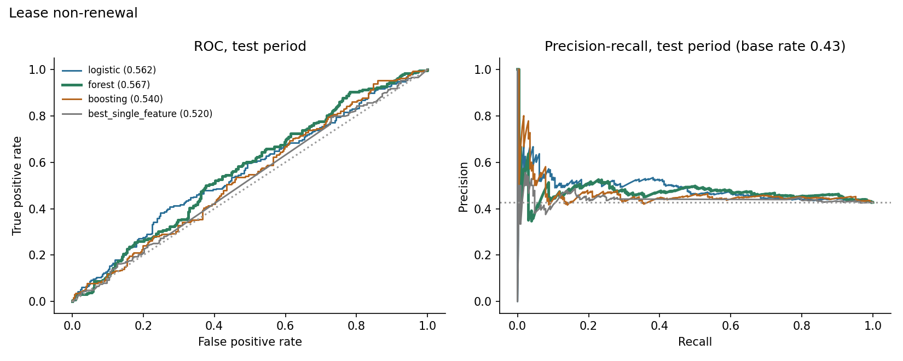
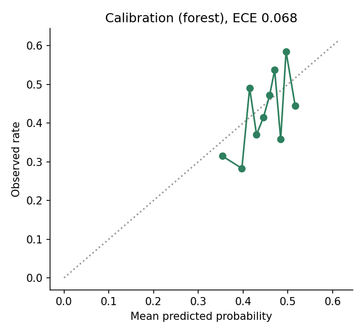
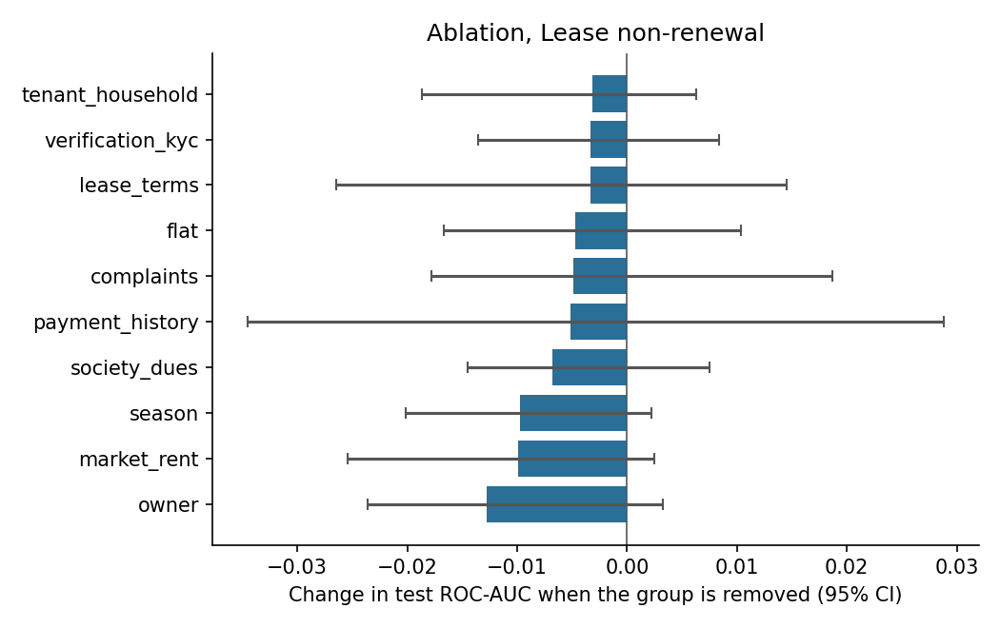
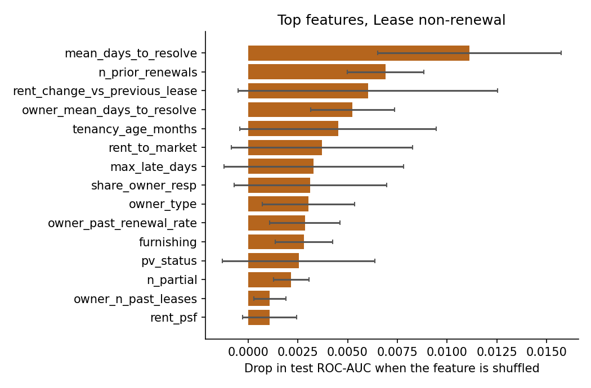
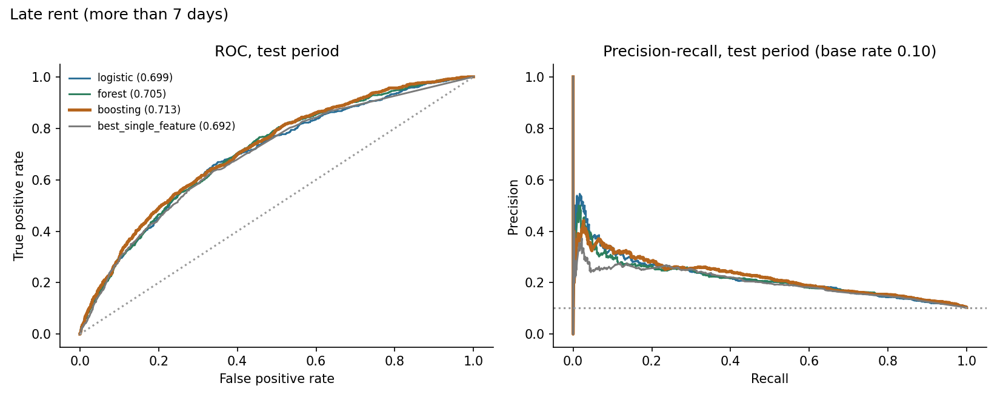
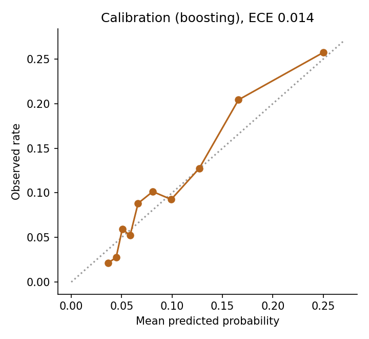
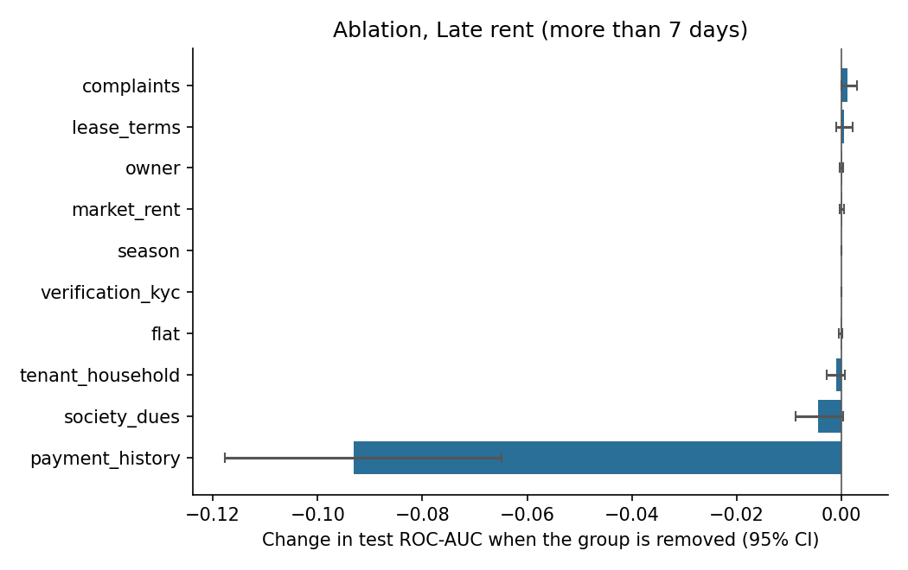
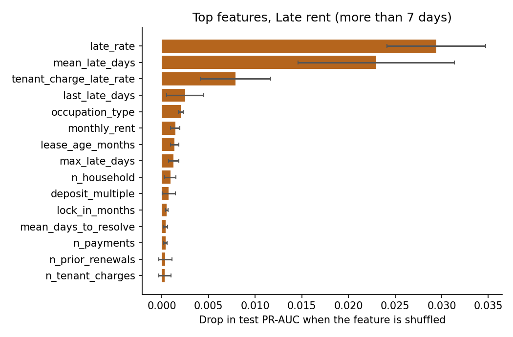

# Results: phase 8 models

All numbers come from the **test period only** (the last 20% of prediction dates), scored once, using models
tuned on the validation period and refit on train+valid. Brackets are 95% cluster-bootstrap intervals
(200 resamples of whole tenants or leases). The data is synthetic: these results describe the
simulator, not real tenants.

## M1: Lease non-renewal

Rows: train 1529, validation 461, test 534. Positive rate 0.456 overall, 0.427 in the test period. Primary model (best on validation): **forest**.

### Test results

| Model | ROC-AUC [95% CI] | PR-AUC [95% CI] | Brier | Precision in top 25% | Lift in top 25% |
|---|---|---|---|---|---|
| logistic | 0.562 [0.516, 0.598] | 0.488 [0.429, 0.551] | 0.249 | 0.493 | 1.15 |
| forest | 0.567 [0.527, 0.601] | 0.474 [0.420, 0.526] | 0.242 | 0.478 | 1.12 |
| boosting | 0.540 [0.496, 0.584] | 0.465 [0.409, 0.529] | 0.251 | 0.478 | 1.12 |
| prevalence | 0.500 | 0.465 | 0.246 |  |  |
| best_single_feature (rent_change_vs_previous_lease) | 0.520 [0.475, 0.563] | 0.442 [0.395, 0.503] |  | 0.440 | 1.03 |

Gain of the primary model over the best single feature (`rent_change_vs_previous_lease`): ROC-AUC +0.045 [-0.013, +0.091], PR-AUC +0.029 [-0.020, +0.074]. For ROC-AUC the interval includes zero; for PR-AUC it includes zero (a gain that is not clearly different from zero).

Calibration (expected calibration error): 0.068.

### Which feature groups matter (ablation)

Change in test ROC-AUC when a group is removed (same hyperparameters, refit), and the AUC when only that group is used.

| Group | Features | Change if removed [95% CI] | AUC using only this group |
|---|---|---|---|
| owner | 5 | -0.013 [-0.024, +0.003] | 0.546 |
| market_rent | 3 | -0.010 [-0.025, +0.002] | 0.497 |
| season | 1 | -0.010 [-0.020, +0.002] | 0.487 |
| society_dues | 3 | -0.007 [-0.014, +0.007] | 0.523 |
| payment_history | 10 | -0.005 [-0.035, +0.029] | 0.530 |
| complaints | 10 | -0.005 [-0.018, +0.019] | 0.523 |
| flat | 4 | -0.005 [-0.017, +0.010] | 0.521 |
| lease_terms | 10 | -0.003 [-0.026, +0.014] | 0.539 |
| verification_kyc | 3 | -0.003 [-0.014, +0.008] | 0.506 |
| tenant_household | 6 | -0.003 [-0.019, +0.006] | 0.492 |

### Permutation importance (primary model)

| Feature | Drop in test score when shuffled |
|---|---|
| mean_days_to_resolve | 0.0111 (sd 0.0046) |
| n_prior_renewals | 0.0069 (sd 0.0019) |
| rent_change_vs_previous_lease | 0.0060 (sd 0.0065) |
| owner_mean_days_to_resolve | 0.0052 (sd 0.0021) |
| tenancy_age_months | 0.0045 (sd 0.0049) |
| rent_to_market | 0.0037 (sd 0.0046) |
| max_late_days | 0.0033 (sd 0.0045) |
| share_owner_resp | 0.0031 (sd 0.0038) |
| owner_type | 0.0030 (sd 0.0023) |
| owner_past_renewal_rate | 0.0028 (sd 0.0018) |

### Do the predictions track the simulator's hidden traits? (diagnostic only)

- spearman prediction vs hidden final satisfaction: -0.055
- oracle auc knowing hidden final satisfaction: 0.598
- oracle auc knowing hidden initial satisfaction: 0.646
- model auc: 0.567

The oracle AUC is what a scorer that knew the hidden trait exactly would reach on the same test rows. It shows how much headroom the data leaves.

### Chosen hyperparameters (selected on validation only)

- logistic: {'C': 1.0}, validation auc 0.5569
- forest: {'leaf': 50}, validation auc 0.5592
- boosting: {'depth': 3, 'lr': 0.03, 'iters': 300, 'l2': 0.0}, validation auc 0.5589

## M2: Late rent (more than 7 days)

Rows: train 20146, validation 6871, test 6905. Positive rate 0.097 overall, 0.103 in the test period. Primary model (best on validation): **boosting**.

### Test results

| Model | ROC-AUC [95% CI] | PR-AUC [95% CI] | Brier | Precision in top 10% | Lift in top 10% |
|---|---|---|---|---|---|
| logistic | 0.699 [0.674, 0.721] | 0.218 [0.190, 0.249] | 0.088 | 0.259 | 2.51 |
| forest | 0.705 [0.683, 0.728] | 0.212 [0.186, 0.239] | 0.088 | 0.247 | 2.40 |
| boosting | 0.713 [0.689, 0.736] | 0.222 [0.198, 0.250] | 0.087 | 0.258 | 2.49 |
| prevalence | 0.500 | 0.095 | 0.093 |  |  |
| best_single_feature (mean_late_days) | 0.692 [0.667, 0.717] | 0.198 [0.172, 0.226] |  | 0.259 | 2.51 |

Gain of the primary model over the best single feature (`mean_late_days`): ROC-AUC +0.020 [+0.011, +0.028], PR-AUC +0.024 [+0.008, +0.039]. For ROC-AUC the interval excludes zero; for PR-AUC it excludes zero.

Calibration (expected calibration error): 0.014.

### Which feature groups matter (ablation)

Change in test ROC-AUC when a group is removed (same hyperparameters, refit), and the AUC when only that group is used.

| Group | Features | Change if removed [95% CI] | AUC using only this group |
|---|---|---|---|
| payment_history | 10 | -0.093 [-0.118, -0.065] | 0.707 |
| society_dues | 3 | -0.005 [-0.009, +0.000] | 0.604 |
| tenant_household | 6 | -0.001 [-0.003, +0.001] | 0.561 |
| flat | 4 | -0.000 [-0.000, +0.000] | 0.537 |
| verification_kyc | 3 | +0.000 [+0.000, +0.000] | 0.505 |
| season | 1 | +0.000 [+0.000, +0.000] | 0.499 |
| market_rent | 3 | +0.000 [-0.000, +0.000] | 0.487 |
| owner | 5 | +0.000 [-0.000, +0.000] | 0.523 |
| lease_terms | 9 | +0.000 [-0.001, +0.002] | 0.547 |
| complaints | 10 | +0.001 [-0.000, +0.003] | 0.519 |

### Permutation importance (primary model)

| Feature | Drop in test score when shuffled |
|---|---|
| late_rate | 0.0294 (sd 0.0053) |
| mean_late_days | 0.0230 (sd 0.0084) |
| tenant_charge_late_rate | 0.0079 (sd 0.0038) |
| last_late_days | 0.0025 (sd 0.0020) |
| occupation_type | 0.0020 (sd 0.0002) |
| monthly_rent | 0.0014 (sd 0.0005) |
| lease_age_months | 0.0013 (sd 0.0005) |
| max_late_days | 0.0013 (sd 0.0006) |
| n_household | 0.0009 (sd 0.0006) |
| deposit_multiple | 0.0007 (sd 0.0007) |

### Do the predictions track the simulator's hidden traits? (diagnostic only)

- spearman prediction vs hidden reliability: -0.631
- oracle auc knowing hidden reliability: 0.775
- model auc: 0.713

The oracle AUC is what a scorer that knew the hidden trait exactly would reach on the same test rows. It shows how much headroom the data leaves.

### Chosen hyperparameters (selected on validation only)

- logistic: {'C': 0.1}, validation ap 0.2024
- forest: {'leaf': 5}, validation ap 0.1977
- boosting: {'depth': 2, 'lr': 0.03, 'iters': 150, 'l2': 0.0}, validation ap 0.2025
