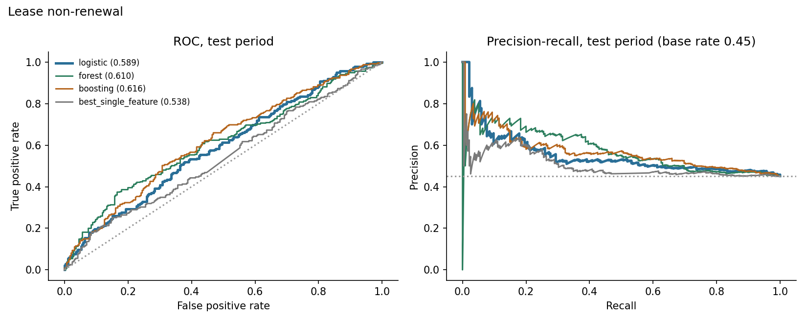
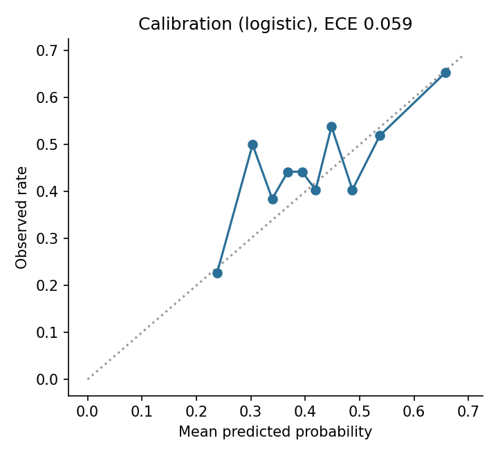
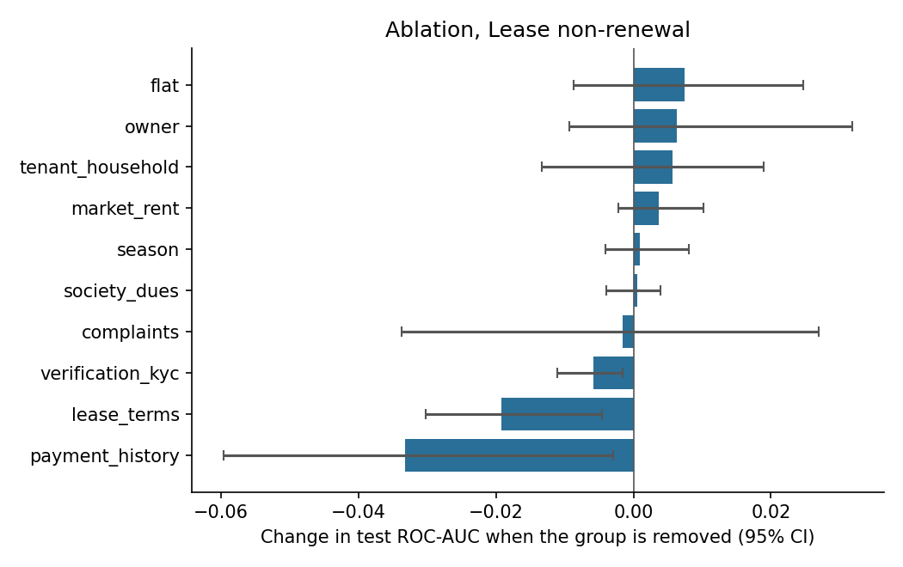
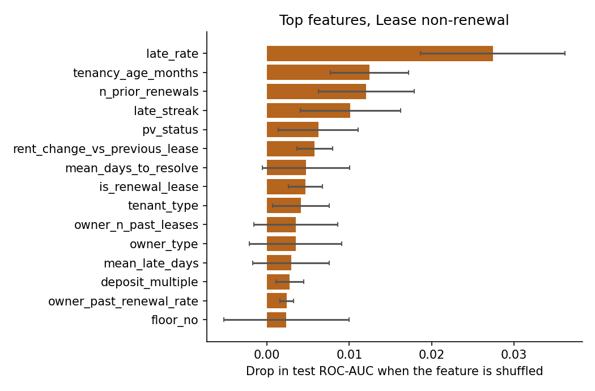
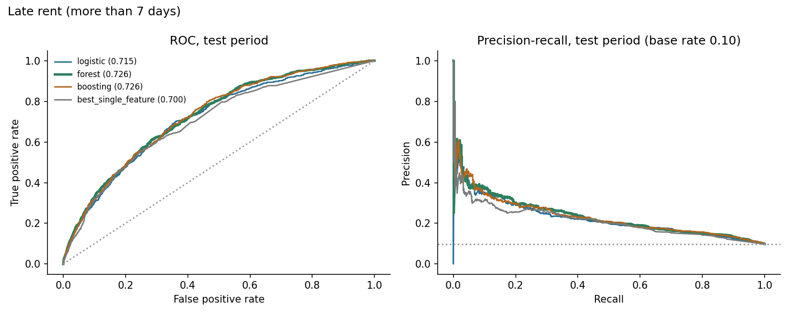
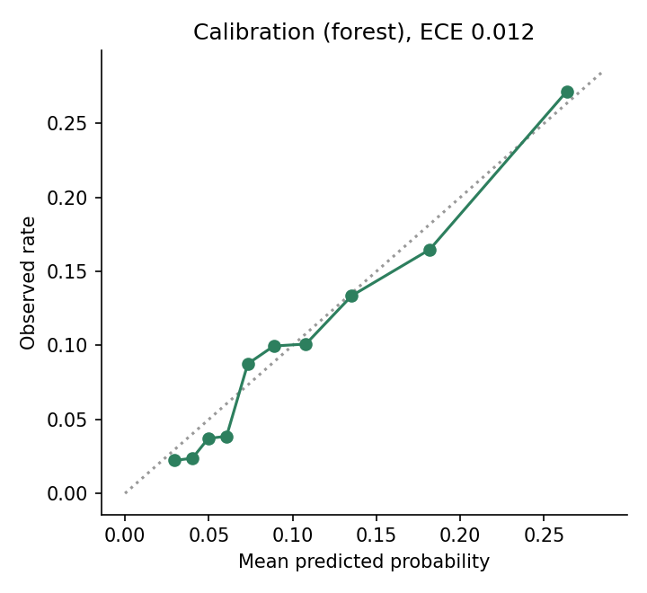
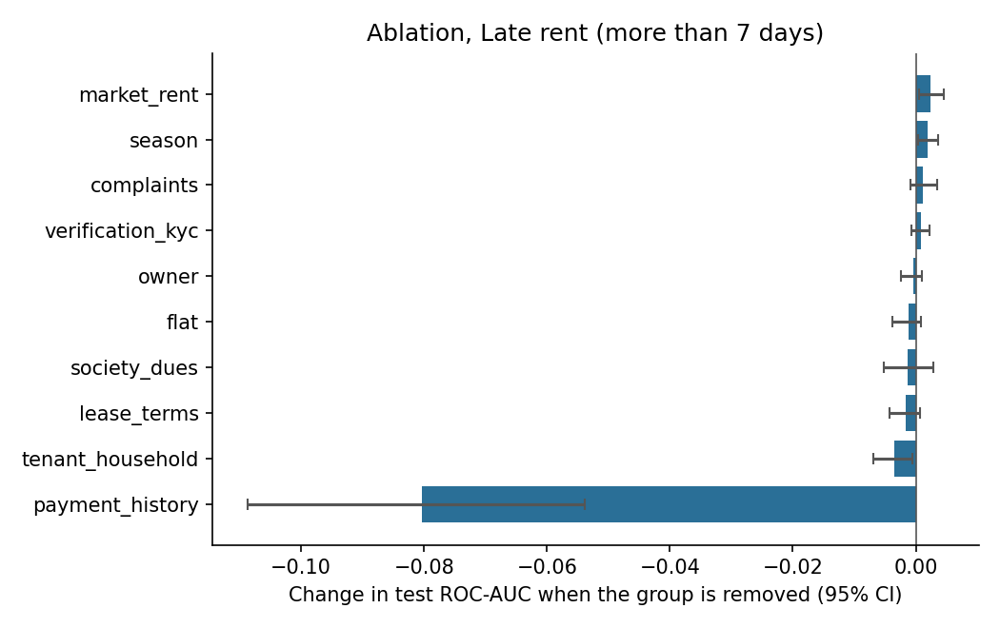
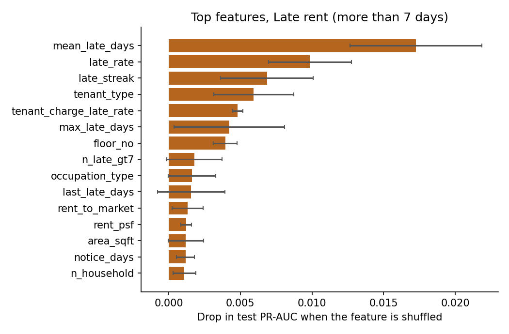

# Results: phase 8 models

All numbers come from the **test period only** (the last 20% of prediction dates), scored once, using models
tuned on the validation period and refit on train+valid. Brackets are 95% cluster-bootstrap intervals
(200 resamples of whole tenants or leases). The data is synthetic: these results describe the
simulator, not real tenants.

## M1: Lease non-renewal

Rows: train 1497, validation 467, test 521. Positive rate 0.452 overall, 0.451 in the test period. Primary model (best on validation): **logistic**.

### Test results

| Model | ROC-AUC [95% CI] | PR-AUC [95% CI] | Brier | Precision in top 25% | Lift in top 25% |
|---|---|---|---|---|---|
| logistic | 0.589 [0.539, 0.637] | 0.550 [0.484, 0.613] | 0.242 | 0.527 | 1.17 |
| forest | 0.610 [0.564, 0.669] | 0.575 [0.517, 0.649] | 0.239 | 0.649 | 1.44 |
| boosting | 0.616 [0.566, 0.663] | 0.569 [0.511, 0.633] | 0.238 | 0.580 | 1.29 |
| prevalence | 0.500 | 0.455 | 0.248 |  |  |
| best_single_feature (mean_days_to_resolve) | 0.538 [0.482, 0.581] | 0.504 [0.440, 0.566] |  | 0.519 | 1.15 |

Gain of the primary model over the best single feature (`mean_days_to_resolve`): ROC-AUC +0.053 [-0.009, +0.121], PR-AUC +0.046 [-0.011, +0.107]. For ROC-AUC the interval includes zero; for PR-AUC it includes zero (a gain that is not clearly different from zero).

Calibration (expected calibration error): 0.059.

### Which feature groups matter (ablation)

Change in test ROC-AUC when a group is removed (same hyperparameters, refit), and the AUC when only that group is used.

| Group | Features | Change if removed [95% CI] | AUC using only this group |
|---|---|---|---|
| payment_history | 10 | -0.033 [-0.060, -0.003] | 0.574 |
| lease_terms | 10 | -0.019 [-0.030, -0.005] | 0.595 |
| verification_kyc | 3 | -0.006 [-0.011, -0.002] | 0.542 |
| complaints | 10 | -0.002 [-0.034, +0.027] | 0.551 |
| society_dues | 3 | +0.001 [-0.004, +0.004] | 0.532 |
| season | 1 | +0.001 [-0.004, +0.008] | 0.500 |
| market_rent | 3 | +0.004 [-0.002, +0.010] | 0.449 |
| tenant_household | 6 | +0.006 [-0.013, +0.019] | 0.531 |
| owner | 5 | +0.006 [-0.009, +0.032] | 0.515 |
| flat | 4 | +0.007 [-0.009, +0.025] | 0.506 |

### Permutation importance (primary model)

| Feature | Drop in test score when shuffled |
|---|---|
| late_rate | 0.0274 (sd 0.0088) |
| tenancy_age_months | 0.0124 (sd 0.0047) |
| n_prior_renewals | 0.0120 (sd 0.0058) |
| late_streak | 0.0101 (sd 0.0061) |
| pv_status | 0.0062 (sd 0.0048) |
| rent_change_vs_previous_lease | 0.0058 (sd 0.0022) |
| mean_days_to_resolve | 0.0048 (sd 0.0053) |
| is_renewal_lease | 0.0047 (sd 0.0021) |
| tenant_type | 0.0041 (sd 0.0035) |
| owner_n_past_leases | 0.0035 (sd 0.0051) |

### Do the predictions track the simulator's hidden traits? (diagnostic only)

- spearman prediction vs hidden final satisfaction: -0.101
- oracle auc knowing hidden final satisfaction: 0.636
- oracle auc knowing hidden initial satisfaction: 0.683
- model auc: 0.589

The oracle AUC is what a scorer that knew the hidden trait exactly would reach on the same test rows. It shows how much headroom the data leaves.

### Chosen hyperparameters (selected on validation only)

- logistic: {'C': 0.01}, validation auc 0.6336
- forest: {'leaf': 50}, validation auc 0.6098
- boosting: {'depth': 2, 'lr': 0.03, 'iters': 150, 'l2': 5.0}, validation auc 0.6106

## M2: Late rent (more than 7 days)

Rows: train 19779, validation 6767, test 6739. Positive rate 0.100 overall, 0.098 in the test period. Primary model (best on validation): **forest**.

### Test results

| Model | ROC-AUC [95% CI] | PR-AUC [95% CI] | Brier | Precision in top 10% | Lift in top 10% |
|---|---|---|---|---|---|
| logistic | 0.715 [0.691, 0.741] | 0.223 [0.189, 0.261] | 0.083 | 0.261 | 2.67 |
| forest | 0.726 [0.701, 0.751] | 0.234 [0.194, 0.276] | 0.083 | 0.272 | 2.77 |
| boosting | 0.726 [0.701, 0.753] | 0.231 [0.197, 0.273] | 0.083 | 0.276 | 2.82 |
| prevalence | 0.500 | 0.101 | 0.088 |  |  |
| best_single_feature (mean_late_days) | 0.700 [0.674, 0.728] | 0.210 [0.176, 0.252] |  | 0.264 | 2.70 |

Gain of the primary model over the best single feature (`mean_late_days`): ROC-AUC +0.026 [+0.018, +0.033], PR-AUC +0.023 [+0.010, +0.041]. For ROC-AUC the interval excludes zero; for PR-AUC it excludes zero.

Calibration (expected calibration error): 0.012.

### Which feature groups matter (ablation)

Change in test ROC-AUC when a group is removed (same hyperparameters, refit), and the AUC when only that group is used.

| Group | Features | Change if removed [95% CI] | AUC using only this group |
|---|---|---|---|
| payment_history | 10 | -0.080 [-0.109, -0.054] | 0.721 |
| tenant_household | 6 | -0.004 [-0.007, -0.000] | 0.589 |
| lease_terms | 9 | -0.002 [-0.004, +0.001] | 0.498 |
| society_dues | 3 | -0.001 [-0.005, +0.003] | 0.603 |
| flat | 4 | -0.001 [-0.004, +0.001] | 0.567 |
| owner | 5 | -0.000 [-0.002, +0.001] | 0.534 |
| verification_kyc | 3 | +0.001 [-0.001, +0.002] | 0.512 |
| complaints | 10 | +0.001 [-0.001, +0.003] | 0.513 |
| season | 1 | +0.002 [+0.000, +0.004] | 0.498 |
| market_rent | 3 | +0.002 [+0.000, +0.005] | 0.533 |

### Permutation importance (primary model)

| Feature | Drop in test score when shuffled |
|---|---|
| mean_late_days | 0.0173 (sd 0.0046) |
| late_rate | 0.0099 (sd 0.0029) |
| late_streak | 0.0069 (sd 0.0032) |
| tenant_type | 0.0059 (sd 0.0028) |
| tenant_charge_late_rate | 0.0048 (sd 0.0003) |
| max_late_days | 0.0042 (sd 0.0039) |
| floor_no | 0.0039 (sd 0.0008) |
| n_late_gt7 | 0.0018 (sd 0.0019) |
| occupation_type | 0.0016 (sd 0.0017) |
| last_late_days | 0.0016 (sd 0.0024) |

### Do the predictions track the simulator's hidden traits? (diagnostic only)

- spearman prediction vs hidden reliability: -0.650
- oracle auc knowing hidden reliability: 0.801
- model auc: 0.726

The oracle AUC is what a scorer that knew the hidden trait exactly would reach on the same test rows. It shows how much headroom the data leaves.

### Chosen hyperparameters (selected on validation only)

- logistic: {'C': 0.01}, validation ap 0.2354
- forest: {'leaf': 50}, validation ap 0.2518
- boosting: {'depth': 3, 'lr': 0.06, 'iters': 150, 'l2': 5.0}, validation ap 0.2446
