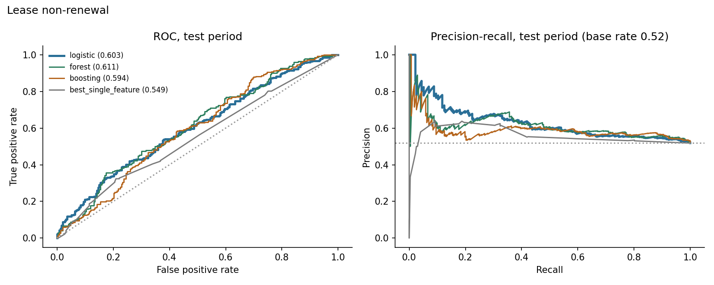
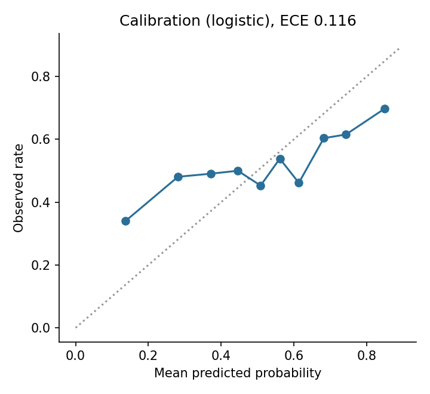
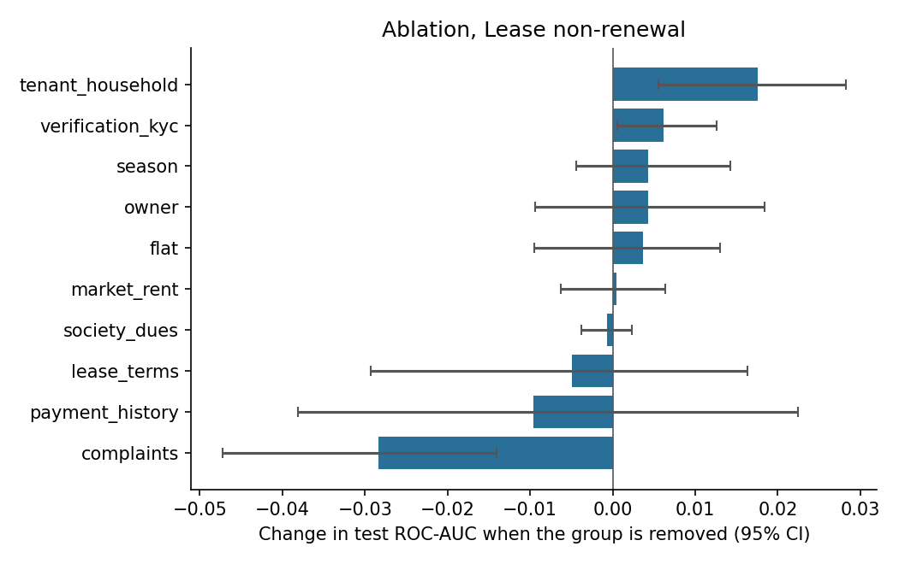
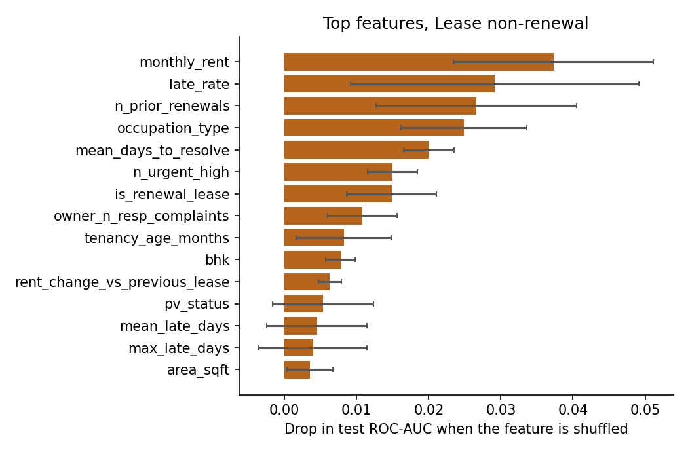

# Results: phase 8 models

All numbers come from the **test period only** (the last 20% of prediction dates), scored once, using models
tuned on the validation period and refit on train+valid. Brackets are 95% cluster-bootstrap intervals
(200 resamples of whole tenants or leases). The data is synthetic: these results describe the
simulator, not real tenants.

## M1: Lease non-renewal

Rows: train 1518, validation 475, test 525. Positive rate 0.547 overall, 0.518 in the test period. Primary model (best on validation): **logistic**.

### Test results

| Model | ROC-AUC [95% CI] | PR-AUC [95% CI] | Brier | Precision in top 25% | Lift in top 25% |
|---|---|---|---|---|---|
| logistic | 0.603 [0.543, 0.650] | 0.629 [0.564, 0.689] | 0.254 | 0.667 | 1.29 |
| forest | 0.611 [0.552, 0.661] | 0.612 [0.550, 0.676] | 0.241 | 0.682 | 1.32 |
| boosting | 0.594 [0.531, 0.647] | 0.590 [0.532, 0.651] | 0.250 | 0.568 | 1.10 |
| prevalence | 0.500 | 0.556 | 0.251 |  |  |
| best_single_feature (late_rate) | 0.549 [0.495, 0.598] | 0.558 [0.498, 0.623] |  | 0.606 | 1.17 |

Gain of the primary model over the best single feature (`late_rate`): ROC-AUC +0.055 [+0.004, +0.108], PR-AUC +0.068 [+0.023, +0.113]. For ROC-AUC the interval excludes zero; for PR-AUC it excludes zero.

Calibration (expected calibration error): 0.116.

### Which feature groups matter (ablation)

Change in test ROC-AUC when a group is removed (same hyperparameters, refit), and the AUC when only that group is used.

| Group | Features | Change if removed [95% CI] | AUC using only this group |
|---|---|---|---|
| complaints | 10 | -0.028 [-0.047, -0.014] | 0.623 |
| payment_history | 10 | -0.010 [-0.038, +0.022] | 0.540 |
| lease_terms | 10 | -0.005 [-0.029, +0.016] | 0.587 |
| society_dues | 3 | -0.001 [-0.004, +0.002] | 0.524 |
| market_rent | 3 | +0.000 [-0.006, +0.006] | 0.546 |
| flat | 4 | +0.004 [-0.009, +0.013] | 0.506 |
| owner | 5 | +0.004 [-0.009, +0.018] | 0.586 |
| season | 1 | +0.004 [-0.004, +0.014] | 0.482 |
| verification_kyc | 3 | +0.006 [+0.001, +0.013] | 0.558 |
| tenant_household | 6 | +0.018 [+0.006, +0.028] | 0.497 |

### Permutation importance (primary model)

| Feature | Drop in test score when shuffled |
|---|---|
| monthly_rent | 0.0373 (sd 0.0139) |
| late_rate | 0.0291 (sd 0.0200) |
| n_prior_renewals | 0.0266 (sd 0.0139) |
| occupation_type | 0.0249 (sd 0.0087) |
| mean_days_to_resolve | 0.0200 (sd 0.0035) |
| n_urgent_high | 0.0150 (sd 0.0035) |
| is_renewal_lease | 0.0148 (sd 0.0062) |
| owner_n_resp_complaints | 0.0108 (sd 0.0048) |
| tenancy_age_months | 0.0082 (sd 0.0066) |
| bhk | 0.0078 (sd 0.0021) |

### Do the predictions track the simulator's hidden traits? (diagnostic only)

- spearman prediction vs hidden final satisfaction: -0.157
- oracle auc knowing hidden final satisfaction: 0.784
- oracle auc knowing hidden initial satisfaction: 0.791
- model auc: 0.603

The oracle AUC is what a scorer that knew the hidden trait exactly would reach on the same test rows. It shows how much headroom the data leaves.

### Chosen hyperparameters (selected on validation only)

- logistic: {'C': 1.0}, validation auc 0.6872
- forest: {'leaf': 5}, validation auc 0.6783
- boosting: {'depth': 3, 'lr': 0.06, 'iters': 150, 'l2': 5.0}, validation auc 0.6837
