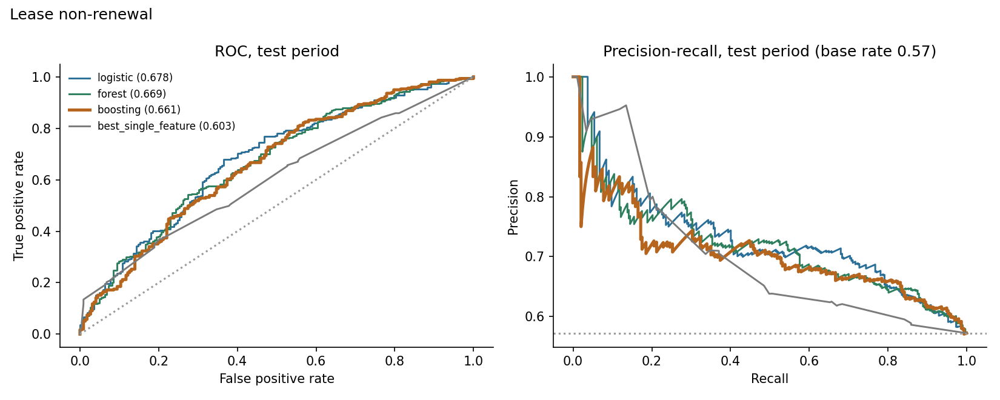
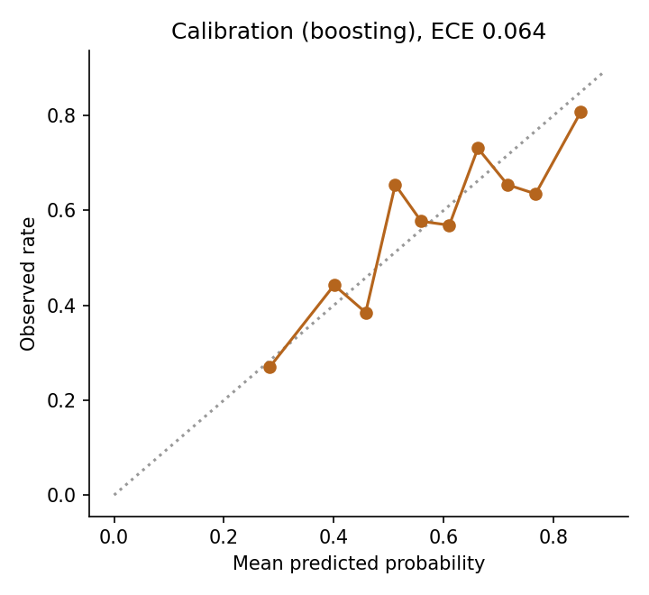
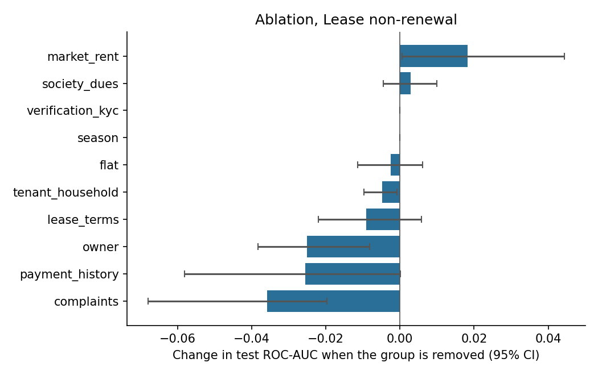
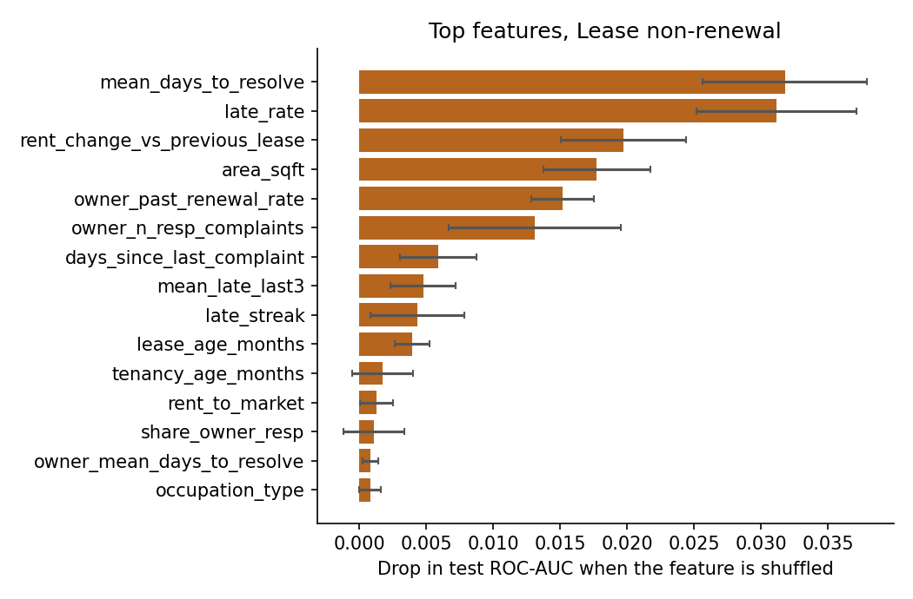

# Results: phase 8 models

All numbers come from the **test period only** (the last 20% of prediction dates), scored once, using models
tuned on the validation period and refit on train+valid. Brackets are 95% cluster-bootstrap intervals
(200 resamples of whole tenants or leases). The data is synthetic: these results describe the
simulator, not real tenants.

## M1: Lease non-renewal

Rows: train 1495, validation 448, test 519. Positive rate 0.542 overall, 0.572 in the test period. Primary model (best on validation): **boosting**.

### Test results

| Model | ROC-AUC [95% CI] | PR-AUC [95% CI] | Brier | Precision in top 25% | Lift in top 25% |
|---|---|---|---|---|---|
| logistic | 0.678 [0.634, 0.722] | 0.729 [0.676, 0.782] | 0.223 | 0.754 | 1.32 |
| forest | 0.669 [0.626, 0.714] | 0.719 [0.661, 0.779] | 0.226 | 0.731 | 1.28 |
| boosting | 0.661 [0.617, 0.707] | 0.706 [0.644, 0.772] | 0.226 | 0.731 | 1.28 |
| prevalence | 0.500 | 0.532 | 0.246 |  |  |
| best_single_feature (late_rate) | 0.603 [0.559, 0.650] | 0.684 [0.637, 0.736] |  | 0.723 | 1.26 |

Gain of the primary model over the best single feature (`late_rate`): ROC-AUC +0.057 [+0.010, +0.108], PR-AUC +0.022 [-0.029, +0.072]. For ROC-AUC the interval excludes zero; for PR-AUC it includes zero (a gain that is not clearly different from zero).

Calibration (expected calibration error): 0.064.

### Which feature groups matter (ablation)

Change in test ROC-AUC when a group is removed (same hyperparameters, refit), and the AUC when only that group is used.

| Group | Features | Change if removed [95% CI] | AUC using only this group |
|---|---|---|---|
| complaints | 10 | -0.036 [-0.068, -0.020] | 0.606 |
| payment_history | 10 | -0.026 [-0.058, +0.000] | 0.596 |
| owner | 5 | -0.025 [-0.038, -0.008] | 0.592 |
| lease_terms | 10 | -0.009 [-0.022, +0.006] | 0.599 |
| tenant_household | 6 | -0.005 [-0.010, -0.001] | 0.568 |
| flat | 4 | -0.003 [-0.011, +0.006] | 0.528 |
| season | 1 | +0.000 [+0.000, +0.000] | 0.476 |
| verification_kyc | 3 | +0.000 [+0.000, +0.000] | 0.585 |
| society_dues | 3 | +0.003 [-0.004, +0.010] | 0.511 |
| market_rent | 3 | +0.018 [+0.001, +0.044] | 0.520 |

### Permutation importance (primary model)

| Feature | Drop in test score when shuffled |
|---|---|
| mean_days_to_resolve | 0.0318 (sd 0.0062) |
| late_rate | 0.0312 (sd 0.0060) |
| rent_change_vs_previous_lease | 0.0198 (sd 0.0047) |
| area_sqft | 0.0177 (sd 0.0040) |
| owner_past_renewal_rate | 0.0152 (sd 0.0024) |
| owner_n_resp_complaints | 0.0131 (sd 0.0064) |
| days_since_last_complaint | 0.0059 (sd 0.0029) |
| mean_late_last3 | 0.0048 (sd 0.0024) |
| late_streak | 0.0043 (sd 0.0035) |
| lease_age_months | 0.0039 (sd 0.0013) |

### Do the predictions track the simulator's hidden traits? (diagnostic only)

- spearman prediction vs hidden final satisfaction: -0.117
- oracle auc knowing hidden final satisfaction: 0.716
- oracle auc knowing hidden initial satisfaction: 0.733
- model auc: 0.661

The oracle AUC is what a scorer that knew the hidden trait exactly would reach on the same test rows. It shows how much headroom the data leaves.

### Chosen hyperparameters (selected on validation only)

- logistic: {'C': 0.01}, validation auc 0.6434
- forest: {'leaf': 20}, validation auc 0.6358
- boosting: {'depth': 2, 'lr': 0.06, 'iters': 150, 'l2': 0.0}, validation auc 0.6535
